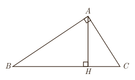

فیلدز نگرفته است». در این صورت شما برای رد ادعای او چه می‌توانید بگویید؟ اگر شما حتی یک فرد ایرانی را که مدال فیلدز گرفته است، برای او مثال بزنید، در این صورت ادعای او باطل شده است و در واقع شما با استفاده از یک مثال نقض، ادعای او را باطل کرده‌اید.

با دقت در ادعای مطرح شده خواهیم دید که کلمۀ «هیچ» در این حکم باعث می‌شود که این ادعا یک حکم کلی برای تمام اعضای یک مجموعه (که در اینجا مجموعۀ افراد ایرانی است) باشد. بنابراین در این مورد نیز آوردن یک مثال نقض کافی است تا آن حکم رد شود و به عبارتی غلط بودن آن حکم اثبات گردد.

در ادامه نمونه‌هایی از حکم‌های کلی آمده‌اند.

الف) همۀ اعداد اول فردند. (حکم کلی دربارۀ تمام اعداد اول)

ب) «در هر مستطیل اندازۀ قطرها باهم برابر است.» (حکم کلی دربارۀ تمام مستطیل‌ها)

پ) «به ازای هر عدد طبیعی $n$، مقدار عبارت $n^2+n+41$ عددی اول است.» (حکم کلی در مورد تمام اعداد طبیعی)

دربارۀ درستی یا نادرستی حکم «الف» چه حدسی می‌زنید؟ چگونه می‌توانید حدس خود را ثابت کنید؟

می‌دانیم که ۲ یک عدد اول و زوج است. بنابراین حکم کلی «الف» با ارائۀ همین مثال نقض رد می‌شود. دربارۀ درستی یا نادرستی حکم‌های «ب» و «پ» چه حدس‌هایی می‌زنید؟ آیا می‌توانید برای آنها مثال نقض بیاورید و آنها را باطل کنید؟

اگر برای یک حکم کلی نتوانیم مثال نقض ارائه کنیم، دربارۀ درستی یا نادرستی آن حکم چه می‌توان گفت؟ آیا در این حالت درستی حکم را باید پذیرفت؟

برای قسمت (ب) مثال نقض وجود ندارد؛ اما این برای پذیرش این حکم کافی نیست و باید توجه کرد که «برای نشان دادن درستی یک حکم کلی باید آن را اثبات کنیم».

دربارۀ گزینۀ (پ) چه می‌توان گفت؟

اگر درستی یا نادرستی یک حکم کلی بر ما مشخص نباشد و برای رد آن، مثال نقض نیز نتوانیم ارائه دهیم، نمی‌توان دربارۀ درستی یا نادرستی آن حکم کلی نتیجه‌ای گرفت.

## تمرین

۱. در شکل مقابل مساحت مثلث قائم‌الزاویۀ $ABC$ را به دو روش محاسبه کنید و از تساوی دو عبارت به‌دست آمده برای مساحت مثلث، یک تناسب به‌دست آورید.

۱ـ مدال یا نشان فیلدز (Fields medal) جایزه‌ای است که به ابتکار ریاضی‌دان کانادایی جان چارلز فیلدز هر چهار سال یک‌بار به ریاضی‌دانان جوان (کمتر از چهل سال) که کار ارزنده‌ای در ریاضی انجام داده باشند تعلق می‌گیرد. از آنجا که در رشتۀ ریاضی جایزۀ نوبل اهدا نمی‌شود، این جایزه را «نوبل ریاضیات» می‌خوانند. در سال ۲۰۱۴ نشان فیلدز به ریاضی‌دان ایرانی خانم مریم میرزاخانی تعلق گرفت. گفتنی است که میرزاخانی اولین زنی در دنیاست که موفق به گرفتن این نشان شده است. البته با تأسف تمام موقع تدوین کتاب خبر درگذشت ایشان، جهان علم و جامعۀ ایرانی را سخت متأثر ساخت، روانش شاد.

