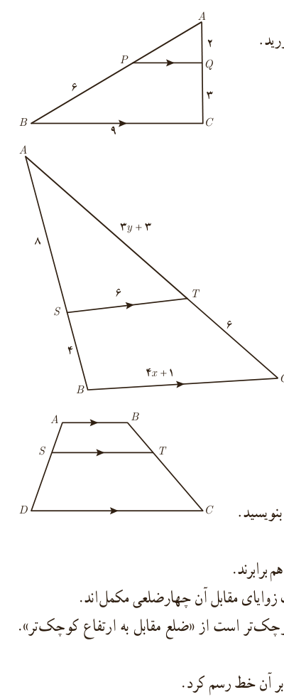

۲. در هر مورد، مقدار عددی نسبت $\frac ab$ را به‌دست آورید.

الف) $\frac a{10+a}=\frac b{8+b}$؛ ب) $\frac{3a+10}{10+2a}=\frac{3b+7}{7+2b}$

۳. ثابت کنید در هر مثلث، پاره‌خطی که وسط‌های دو ضلع مثلث را به هم وصل کند، با ضلع سوم موازی و مساوی نصف آن است.

۴. در شکل مقابل $PQ\parallel BC$ است. طول پاره‌خط‌های $AP$ و $PQ$ را به‌دست آورید.

۵. در شکل مقابل $ST\parallel BC$ است. مقادیر $x$ و $y$ را به‌دست آورید.

۶. در ذوزنقۀ مقابل $AB\parallel ST\parallel DC$ است. ثابت کنید: $\frac{AS}{SD}=\frac{BT}{TC}$. (راهنمایی: یکی از قطرها را رسم کنید.)

۷. در هر مورد با عوض کردن جای فرض و حکم عکس آنچه را داده شده است، بنویسید.

الف) اگر در مثلثی سه ضلع برابر باشند، آنگاه سه زاویه نیز برابر خواهند بود.

ب) اگر در یک چهارضلعی اضلاع روبه‌رو موازی باشند، در این صورت زاویه‌های مقابل با هم برابرند.

پ) اگر رأس‌های یک چهارضلعی روی یک دایره قرار داشته باشند، در این صورت زاویه‌های مقابل آن چهارضلعی مکمل‌اند.

ت) در یک مثلث اگر دو ارتفاع نابرابر باشند، «ضلع متناظر به ارتفاع بزرگ‌تر» کوچک‌تر است از «ضلع مقابل به ارتفاع کوچک‌تر». (راهنمایی: شکل بکشید و به زبان ریاضی بنویسید.)

۸. با برهان خلف ثابت کنید نمی‌توان از یک نقطۀ غیر واقع بر یک خط، دو عمود بر آن خط رسم کرد.

۹. هر یک از حکم‌های کلی زیر را با یک مثال نقض رد کنید.

الف) هیچ عدد اول بزرگ‌تر از ۱۲۷ وجود ندارد.

ب) مساحت هر مثلث از مساحت هر مربع بیشتر است.

پ) در هر مثلث اندازۀ هر ضلع از اندازۀ هر ارتفاع بزرگ‌تر است.

ت) در هر مثلث میانه و عمودمنصف متناظر به هر ضلع بر هم منطبق‌اند.

