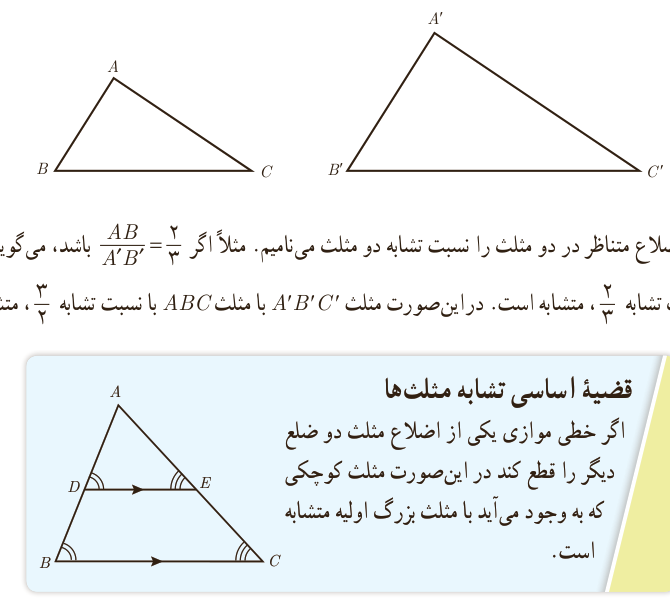

# درس سوم ـ تشابه مثلث‌ها

در پایۀ نهم با مفهوم تشابه آشنا شدید. با توجه به مفهوم تشابه، دو مثلث $ABC$ و $A'B'C'$ متشابه‌اند؛ هرگاه زوایای متناظر باهم برابر باشند و نسبت اضلاع متناظر در دو مثلث یکسان باشد؛ یعنی:

$$\triangle ABC\sim\triangle A'B'C'\Leftrightarrow\begin{cases}\hat A=\hat A',\ \hat B=\hat B',\ \hat C=\hat C'\\\frac{AB}{A'B'}=\frac{AC}{A'C'}=\frac{BC}{B'C'}\end{cases}$$

در این‌صورت نسبت اضلاع متناظر در دو مثلث را نسبت تشابه دو مثلث می‌نامیم. مثلاً اگر $\frac{AB}{A'B'}=\frac23$ باشد، می‌گوییم مثلث $ABC$ با مثلث $A'B'C'$ با نسبت تشابه $\frac23$ متشابه است. در این‌صورت مثلث $A'B'C'$ با مثلث $ABC$ با نسبت تشابه $\frac32$ متشابه خواهد بود.

## قضیۀ اساسی تشابه مثلث‌ها

اگر خطی موازی یکی از اضلاع مثلث دو ضلع دیگر را قطع کند در این‌صورت مثلث کوچکی که به وجود می‌آید با مثلث بزرگ اولیۀ متشابه است.

اثبات:

۱ـ داریم $\hat D=\hat B$ و $\hat E=\hat C$ (چرا؟) بنابراین زاویه‌های دو مثلث نظیر به نظیر باهم برابرند.

۲ـ با توجه به قضیۀ تالس داریم: $\frac{AD}{\ldots}=\frac{\ldots}{AC}=\frac{DE}{\ldots}$.

۳ـ با توجه به (۱) و (۲) و تعریف تشابه داریم: $\triangle ADE\sim\triangle ABC$.

