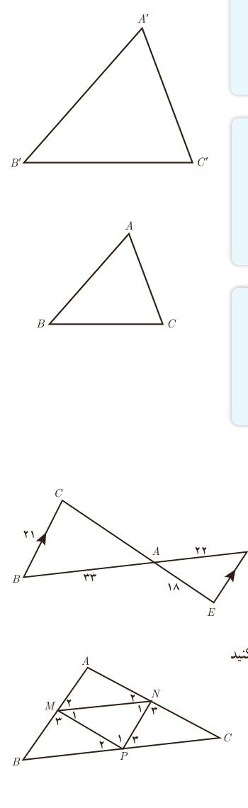

با استفاده از قضیۀ اساسی تشابه مثلث‌ها می‌توان سه قضیۀ بعد را که حالت‌های تشابه دو مثلث را بیان می‌کنند، اثبات کرد. از آنجا که اثبات این قضیه‌ها مدنظر نیست، در ادامه تنها صورت آنها بیان شده است.

قضیۀ ۱: هرگاه دو زاویه از مثلثی با دو زاویه از مثلث دیگر برابر باشند، دو مثلث متشابه‌اند.

$$(\hat A=\hat A'\ \text{و}\ \hat B=\hat B'\Rightarrow\triangle ABC\sim\triangle A'B'C')$$

قضیۀ ۲: هرگاه اندازه‌های دو ضلع از مثلثی با اندازه‌های دو ضلع از مثلث دیگر متناسب باشند و زاویۀ بین آنها برابر باشند، دو مثلث متشابه‌اند.

$$\left(\frac{AB}{A'B'}=\frac{AC}{A'C'},\ \hat A=\hat A'\Rightarrow\triangle ABC\sim\triangle A'B'C'\right)$$

قضیۀ ۳: هرگاه اندازه‌های سه ضلع از مثلثی با اندازه‌های سه ضلع از مثلث دیگر متناسب باشند، دو مثلث متشابه‌اند.

$$\frac{AB}{A'B'}=\frac{AC}{A'C'}=\frac{BC}{B'C'}\Rightarrow\triangle ABC\sim\triangle A'B'C'$$

## کار در کلاس

۱. در شکل مقابل $BC\parallel DE$. اندازۀ پاره‌خط‌های $DE$ و $CA$ را به دست آورید.

۲. اگر نقاط $P$ و $N$ و $M$ مطابق شکل وسط‌های اضلاع مثلث $ABC$ باشند، ثابت کنید مثلث‌های $ABC$ و $MNP$ متشابه‌اند.

حل: الف) $MN\parallel BC$ و $NP\parallel AB$ و $MP\parallel AC$ چرا؟

ب) بنابراین $\hat M_1=\hat P_2=\hat C$ و $\hat N_1=\hat P_3=\hat B$ (چرا؟)

از (ب) دربارۀ مثلث‌های مورد نظر چه نتیجه‌ای می‌توان گرفت؟

