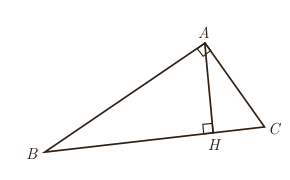

۳. اگر سه مثلث $ABC$ و $A'B'C'$ و $A''B''C''$ به‌گونه‌ای باشند که $\triangle ABC\sim\triangle A'B'C'$ و $\triangle A'B'C'\sim\triangle A''B''C''$، دربارۀ دو مثلث $ABC$ و $A''B''C''$ چه می‌توان گفت؟ چرا؟

## برخی روابط طولی در مثلث قائم‌الزاویه
### فعالیت

فرض کنید مثلث $ABC$ مانند شکل یک مثلث قائم‌الزاویه و $AH$ ارتفاع وارد بر وتر آن باشد.

۱. نشان دهید دو زاویه از مثلث $AHC$ با دو زاویه از مثلث $ABC$ برابرند و نتیجه بگیرید: $\triangle ABC\sim\triangle AHC$.

۲. نشان دهید دو زاویۀ مثلث $AHB$ با دو زاویه از مثلث $ABC$ برابر است و نتیجه بگیرید: $\triangle ABC\sim\triangle AHB$.

۳. از (۱) و (۲) دربارۀ مثلث‌های $AHC$ و $AHB$ چه نتیجه‌ای می‌گیرید؟

نتیجه: در هر مثلث قائم‌الزاویه، ارتفاع وارد بر وتر، دو مثلث قائم‌الزاویه به وجود می‌آورد که این دو مثلث با هم و با مثلث اصلی متشابه‌اند.

۴. $\triangle ABC\sim\triangle AHC\Rightarrow\frac{AH}{\ldots}=\frac{AC}{\ldots}=\frac{HC}{\ldots}\Rightarrow AC^2=\ldots\times\ldots$

۵. $\triangle ABC\sim\triangle AHB\Rightarrow\frac{AH}{\ldots}=\frac{AB}{\ldots}=\frac{HB}{\ldots}\Rightarrow AB^2=\ldots\times\ldots$

۶. $\triangle AHB\sim\triangle AHC\Rightarrow\frac{AH}{\ldots}=\frac{AC}{\ldots}=\frac{HC}{\ldots}\Rightarrow AH^2=\ldots\times\ldots$

۷. با جمع طرفین روابط ۴ و ۵ رابطۀ فیثاغورس را برای مثلث $ABC$ نتیجه بگیرید: $BC^2=\ldots+\ldots$.

۸. مساحت مثلث $ABC$ را به دو طریق محاسبه و با توجه به آن تساوی زیر را کامل کنید: $AB\times\ldots=AH\times\ldots$.

