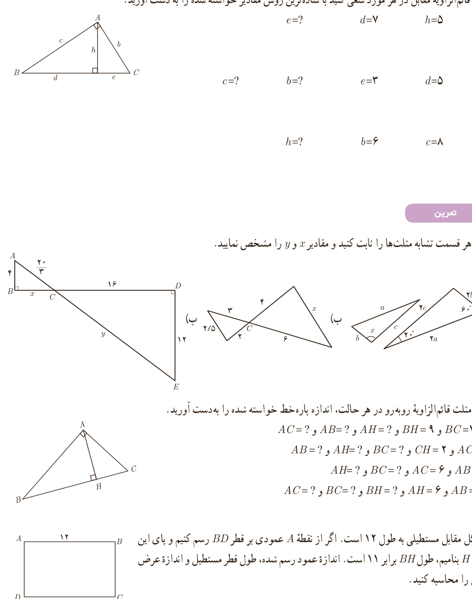

## کار در کلاس

در مثلث قائم‌الزاویۀ مقابل در هر مورد سعی کنید با ساده‌ترین روش مقادیر خواسته شده را به دست آورید.

۱. $h=5$، $d=7$، $e=?$

۲. $d=5$، $e=3$، $b=?$، $c=?$

۳. $c=8$، $b=6$، $h=?$

## تمرین

۱. در هر قسمت تشابه مثلث‌ها را ثابت کنید و مقادیر $x$ و $y$ را مشخص نمایید.

۲. در مثلث قائم‌الزاویۀ روبه‌رو در هر حالت، اندازۀ پاره‌خط خواسته شده را به‌دست آورید.

الف) $BC=10$ و $BH=9$، $AH=?$ و $AB=?$ و $AC=?$

ب) $AC=5$ و $CH=2$، $BC=?$ و $AH=?$ و $AB=?$

پ) $AB=8$ و $AC=6$، $BC=?$ و $AH=?$

ت) $AB=12$ و $AH=6$، $BH=?$ و $BC=?$ و $AC=?$

۳. شکل مقابل مستطیلی به طول ۱۲ است. اگر از نقطۀ $A$ عمودی بر قطر $BD$ رسم کنیم و پای این عمود را $H$ بنامیم، طول $BH$ برابر ۱۱ است. اندازۀ عمود رسم شده، طول قطر مستطیل و اندازۀ عرض مستطیل را محاسبه کنید.

