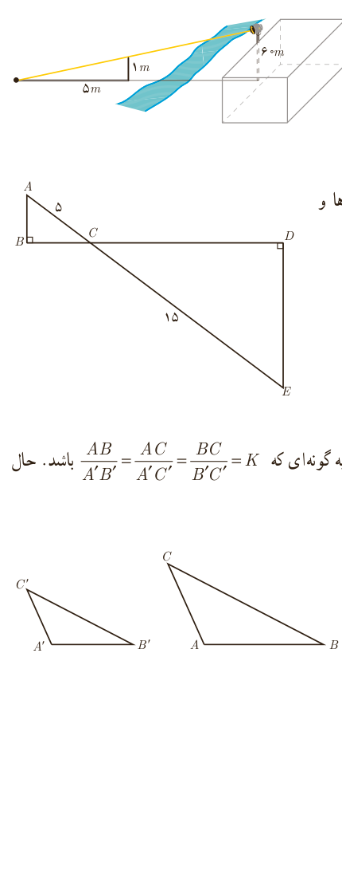

۴. بر دیوار یک کمپ نظامی نورافکنی به ارتفاع ۶۰ متر (مانند شکل) قرار گرفته است. فردی که در طرف دیگر رودخانه است، می‌خواهد فاصلۀ خود را تا پایۀ نورافکن محاسبه کند. برای این کار چوبی به طول یک متر را روی زمین قرار می‌دهد و مشاهده می‌کند که طول سایۀ چوب برابر ۵ متر است. فاصلۀ این مرد تا پای نورافکن چقدر است؟

۵. در شکل مقابل دو مثلث قائم‌الزاویه مشاهده می‌کنید. نسبت محیط‌ها و مساحت‌های آنها را به‌دست آورید.

۶. دو مثلث متشابه $ABC$ و $A'B'C'$ را با نسبت تشابه $K$ در نظر بگیرید؛ به‌گونه‌ای که $\frac{AB}{A'B'}=\frac{AC}{A'C'}=\frac{BC}{B'C'}=K$ باشد. حال ارتفاع‌های $AH$ و $A'H'$ را در دو مثلث رسم کنید.

الف) ثابت کنید مثلث‌های $AHB$ و $A'H'B'$ متشابه‌اند.

ب) نسبت $\frac{AH}{A'H'}$ را به‌دست آورید.

پ) نسبت مساحت‌های $\frac{S_{ABC}}{S_{A'B'C'}}$ را محاسبه کنید.

ت) نسبت محیط‌های دو مثلث $ABC$ و $A'B'C'$ را به‌دست آورید.

