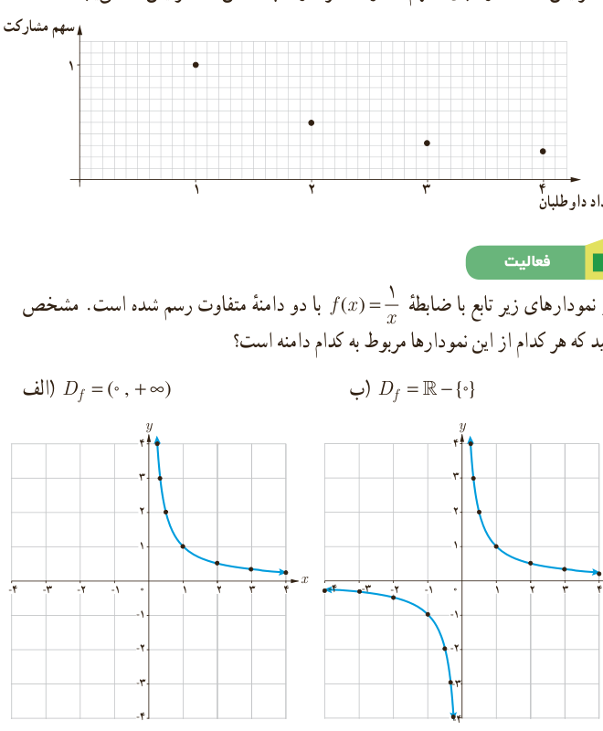

۲. در شکل زیر، بخشی از نمودار تابع سهم مشارکت رسم شده است. با انتخاب گزینۀ مناسب در عبارت زیر، تعیین کنید که این نمودار چه چیزی را نشان می‌دهد؟

«با افزایش تعداد داوطلبان، سهم مشارکت هر داوطلب کاهش □ افزایش □ می‌یابد.»

## فعالیت

در نمودارهای زیر تابع با ضابطۀ $f(x)=\frac1x$ با دو دامنۀ متفاوت رسم شده است. مشخص کنید که هر کدام از این نمودارها مربوط به کدام دامنه است؟

الف) $D_f=(0,+\infty)$؛ ب) $D_f=\mathbb R-\{0\}$

هر تابع به شکل $f(x)=\frac{P(x)}{Q(x)}$ را یک تابع گویا می‌نامیم، که در آن $P(x)$، $Q(x)$ چند جمله‌ای هستند و چند جمله‌ای $Q(x)$ صفر نیست.

تابع با ضابطۀ $f(x)=\frac1x$ و همچنین توابع زیر نمونه‌هایی از توابع گویا هستند:

$$f(x)=\frac{x}{x+5},\quad f(x)=\frac{x+3}{x-10},\quad f(x)=\sqrt5x,\quad f(x)=2$$

## خواندنی

هزینۀ پاک‌سازی $x$ درصد از آلودگی‌های شهری و صنعتی رودخانه‌ای با تابع با ضابطۀ $p(x)=\frac{255x}{100-x}$ محاسبه می‌شود که در آن $x$ درصد آلودگی و $p(x)$ هزینۀ پاک‌سازی بر حسب میلیون تومان است.

الف) جدول زیر را کامل کنید.

ب) با یک میلیارد تومان چه درصدی از آلودگی‌های این رودخانه پاک‌سازی خواهد شد؟

پ) چرا هیچ‌گاه ۱۰۰ درصد از آلودگی‌های این رودخانه پاک‌سازی نمی‌شود؟

| $x$ | ۱۰ | ۳۰ | ۵۰ | ۷۰ | ۹۰ |
|---|---|---|---|---|---|
| $p(x)$ | | | | | |
