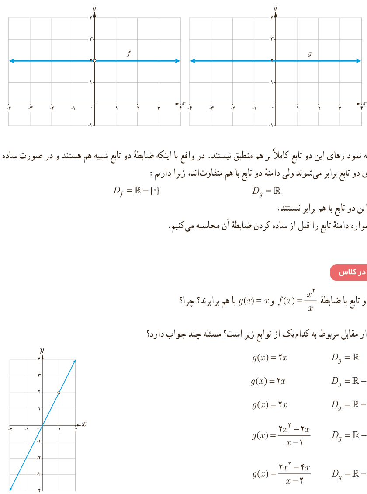

به نمودار دو تابع با ضابطۀ $f(x)=\frac{2x}{x}$ و $g(x)=2$ دقت کنید.

می‌بینیم که نمودارهای این دو تابع کاملاً بر هم منطبق نیستند. در واقع با اینکه ضابطۀ دو تابع شبیه هم هستند و در صورت ساده شدن $x$، ضابطه‌های دو تابع برابر می‌شوند ولی دامنۀ دو تابع با هم متفاوت‌اند، زیرا داریم:

$$D_f=\mathbb R-\{0\},\qquad D_g=\mathbb R$$

در نتیجه این دو تابع با هم برابر نیستند.

تذکر: همواره دامنۀ تابع را قبل از ساده کردن ضابطۀ آن محاسبه می‌کنیم.

## کار در کلاس

۱. آیا دو تابع با ضابطۀ $f(x)=\frac{x^2}{x}$ و $g(x)=x$ با هم برابرند؟ چرا؟

۲. نمودار مقابل مربوط به کدام‌یک از توابع زیر است؟ مسئله چند جواب دارد؟

الف) $g(x)=2x$، $D_g=\mathbb R$

ب) $g(x)=2x$، $D_g=\mathbb R-\{2\}$

پ) $g(x)=2x$، $D_g=\mathbb R-\{1\}$

ت) $g(x)=\frac{2x^2-2x}{x-1}$، $D_g=\mathbb R-\{1\}$

ث) $g(x)=\frac{2x^2-4x}{x-2}$، $D_g=\mathbb R-\{2\}$
