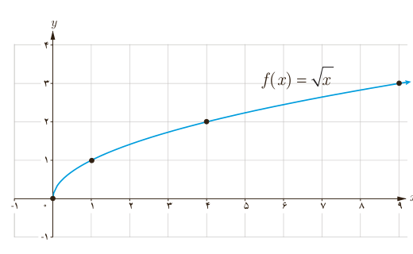

## توابع رادیکالی
### فعالیت

بر اساس مشاهدات دانشمندان، اگر $S$ تندی جابه‌جایی یک سونامی بر حسب کیلومتر بر ساعت باشد، می‌توان آن را از رابطۀ $S=356\sqrt d$ محاسبه کرد که در آن $d$ میانگین عمق دریا بر حسب کیلومتر است.

الف) جدول زیر را کامل کنید. ($\sqrt2\simeq1.4$، $\sqrt3\simeq1.7$)

| $d$ | ۱ | ۲ | ۳ | ۴ |
|---|---|---|---|---|
| $S=356\sqrt d$ | | ۴۹۸٫۴ | | |

ب) عبارت زیر را کامل کنید.

چون هر عدد، تنها .... ریشۀ دوم مثبت دارد، پس رابطۀ سونامی یک تابع .... .

پ) کدام‌یک از اعداد $-5$ و ۵ عضو دامنۀ تابع سونامی است؟

مطالعۀ توابع رادیکالی مانند $S=356\sqrt d$ به‌دلیل نقش کاربردی آنهاست. در این کتاب با برخی از توابع رادیکالی آشنا می‌شویم. همان‌طور که هنگام کار با تابع رادیکالی سونامی دیدید، دامنۀ این نوع توابع ممکن است همۀ اعداد حقیقی نباشد.

ساده‌ترین تابع رادیکالی تابع با ضابطۀ $f(x)=\sqrt x$ است. دامنۀ این تابع مجموعۀ همۀ اعداد حقیقی نامنفی و نمودار آن به‌صورت زیر است.

## خواندنی

سونامی (آب‌لرزه) به لرزش شدید آب دریا گفته می‌شود. این اتفاق ممکن است در پی زمین‌لرزه‌های زیر دریا، لغزیدن صخره، انفجار آتشفشانی و یا هر حادثۀ دیگری که انرژی زیادی در دریا آزاد می‌کند، رخ دهد. آبی که به لرزه درآمده است، به‌شکل موج‌های عظیم به کرانه‌ها می‌رسد و ویرانی به بار می‌آورد. سونامی زمانی شروع می‌شود که حجم عظیمی از آب، به سرعت مرتفع شود. تندی موج‌های سونامی بسته به محل رویداد، ممکن است به بیش از ۸۰۰ کیلومتر در ساعت برسد!

یکی از بزرگ‌ترین سونامی‌ها در سال ۱۳۸۳ در نزدیکی سوماترای اندونزی روی داد و باعث ویرانی عظیمی شد و حدود ۲۰۰ هزار نفر را به کام مرگ کشانید.

در کتاب‌های تاریخ ادعا شده است که قسمت بزرگی از بندر باستانی سیراف ناگهان بر اثر زمین‌لرزه‌ای به زیر آب رفته است. پاسخ دقیق این سؤال را که «آیا یک سونامی سیراف را ویران کرده و به زیر آب برده است؟» باید با کمک پژوهش‌های باستان‌شناسی و زمین‌شناسی یافت. با توجه به اینکه میانگین عمق خلیج فارس حدود ۵۰ متر است، نظر شما چیست؟
