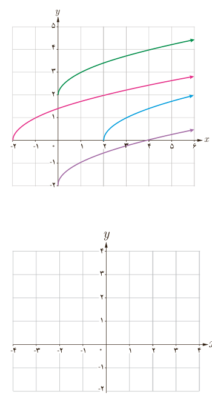

## فعالیت

۱. در شکل مقابل با کمک انتقال نمودار تابع با ضابطۀ $f(x)=\sqrt x$، نمودار مربوط به هر یک از توابع زیر رسم شده است. مشخص کنید که هر نمودار، مربوط به کدام تابع است. سپس دامنۀ آنها را تعیین کنید.

الف) $g(x)=\sqrt{x-2}$، $D_g=\ldots$؛ ب) $h(x)=\sqrt x+2$، $D_h=\ldots$؛ پ) $k(x)=\sqrt{x+2}$، $D_k=\ldots$؛ ت) $l(x)=\sqrt x-2$، $D_l=\ldots$.

۲. نمودار تابع با ضابطۀ $y=-2+\sqrt{x+3}$ را رسم کنید. با توجه به شکل می‌بینید که دامنۀ این تابع $[-3,+\infty)$ است. چگونه می‌توان بدون استفاده از نمودار تابع و تنها با توجه به ضابطۀ آن، دامنۀ تابع را تعیین کرد؟

۳. تابع با ضابطۀ $f(x)=\sqrt{3x-6}$ را در نظر بگیرید.

الف) مقادیر $f(1)$، $f(2)$ و $f(3)$ را در صورت وجود بیابید.

ب) آیا می‌توان گفت دامنۀ این تابع همانند تابع $f(x)=\sqrt x$، اعداد نامنفی است؟ چرا؟

پ) می‌دانیم برای بامعنی بودن هر رادیکال با فرجۀ زوج، عبارت زیر رادیکال باید نامنفی باشد. بنابراین برای معلوم کردن دامنۀ تابع $f(x)=\sqrt{3x-6}$ به‌صورت زیر عمل می‌کنیم:

$$3x-6\ge0\Rightarrow3x\ge\ldots\Rightarrow x\ge\ldots$$

دامنۀ تابع $f$ بازۀ .... است.

۴. دامنۀ تابع با ضابطۀ $f(x)=\sqrt{-x^2+1}$، به‌صورت $[-1,1]$ است. در مورد آن با دوستان خود بحث کنید.

۵. دامنۀ تابع با ضابطۀ $g(x)=\sqrt{x^2-4}$ را به‌دست آورید.

