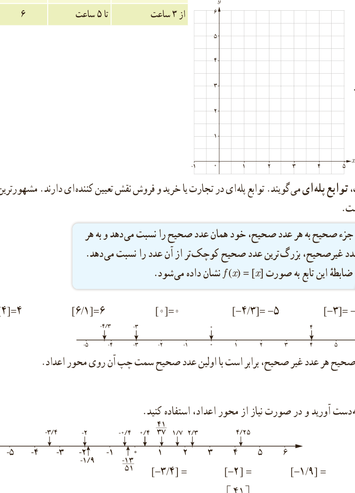

## تابع جزء صحیح
### فعالیت: هزینۀ پارکینگ خودرو

در یک پارکینگ، هزینۀ پارک خودرو به این صورت محاسبه می‌شود:

| زمان | تا | هزینه (هزار تومان) |
|---|---|---|
| از هنگام ورود | تا کمتر از ۲ ساعت | ۳ |
| از ۲ ساعت | تا ۲٫۵ ساعت | ۴ |
| از بیشتر از ۲٫۵ ساعت | تا کمتر از ۳ ساعت | ۵ |
| از ۳ ساعت | تا ۵ ساعت | ۶ |

الف) ضابطۀ تابع هزینۀ پارکینگ خودرو چیست؟

$$f(x)=\begin{cases}3&0\le x<2\\4&2\le x\le\ldots\\5&\ldots\\6&\ldots\end{cases}$$

ب) نمودار این تابع را رسم کنید.

به توابعی مانند تابع هزینۀ پارکینگ، توابع پله‌ای می‌گویند. توابع پله‌ای در تجارت یا خرید و فروش نقش تعیین‌کننده‌ای دارند. مشهورترین تابع پله‌ای، تابع جزء صحیح است.

تابع جزء صحیح به هر عدد صحیح، خود همان عدد صحیح را نسبت می‌دهد و به هر عدد غیرصحیح، بزرگ‌ترین عدد صحیح کوچک‌تر از آن عدد را نسبت می‌دهد. ضابطۀ این تابع به صورت $f(x)=[x]$ نشان داده می‌شود.

برای مثال داریم: $[4]=4$، $[6.1]=6$، $[0]=0$، $[-4.3]=-5$، $[-3]=-3$.

همان‌طور که در مثال دیدیم، جزء صحیح هر عدد غیر صحیح، برابر است با اولین عدد صحیح سمت چپ آن روی محور اعداد.

## کار در کلاس

۱. جزء صحیح اعداد زیر را به‌دست آورید و در صورت نیاز از محور اعداد استفاده کنید.

$$[-3.4]=\quad[-2]=\quad[-1.9]=\quad[0.4]=\quad[-0.4]=$$
$$[4.25]=\quad[\frac{41}{37}]=\quad[2.3]=\quad[1.7]=\quad[-\frac{13}{51}]=$$

