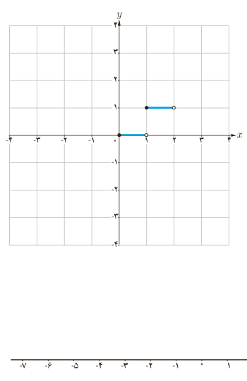

۲. حاصل $[1]+[\sqrt2]+[\sqrt3]+\cdots+[\sqrt{10}]$ را به‌دست آورید.

۳. حاصل $[x]+[2x]+[3x]$ را به ازای $x=-\frac53$ به‌دست آورید.

## کار در کلاس

۱. معادلات مقابل را حل کنید. الف) $[x-1]=2$؛ ب) $[2x+3]=-1$.

۲. جاهای خالی را در جدول مقابل پر کنید و به کمک آن ضابطۀ تابع زیر را تکمیل کنید.

| $x$ | $-x$ | $[x]$ | $[-x]$ | $[x]+[-x]$ |
|---|---|---|---|---|
| ۱ | | | | |
| −۲ | | | | |
| ۳٫۲ | | | | |
| $1/2$ | | | | |
| $\sqrt2$ | | | | |
| ۰ | | | | |
| ... | | | | |

$$[x]+[-x]=\begin{cases}0&x\in\mathbb Z\\\ldots&x\notin\mathbb Z\end{cases}$$

## فعالیت

۱. اگر $[x]=2$، آنگاه $x$ برابر چه اعدادی می‌تواند باشد؟ مجموعۀ جواب را به‌صورت بازه بنویسید.

۲. برای رسم نمودار یک تابع جزء صحیح باید توجه کنیم که اعداد هر بازه‌ای از دامنه، به چه عددی نسبت داده می‌شود. برای مثال اگر $0\le x<1$، آنگاه $[x]=0$؛ پس مقدار تابع با ضابطۀ $f(x)=[x]$ برای همۀ اعداد عضو بازۀ $[0,1)$ برابر صفر می‌شود. در شکل مقابل بخشی از نمودار تابع با ضابطۀ $f(x)=[x]$ رسم شده است. نمودار این تابع را در بازۀ $[-4,4)$ تکمیل کنید.

۳. الف) به دلخواه نقطه‌ای مانند $a$ را روی محور اعداد داده شده مشخص کنید.

ب) نقطۀ $a+3$ را روی این محور مشخص کنید.

پ) نقاط $[a]$ و $[a+3]$ را روی محور مشخص کنید.

ت) چه رابطه‌ای بین $[a]$ و $[a+3]$ برقرار است؟ $[a+3]=[a]+\ldots$

ث) چه نتیجه‌ای می‌گیرید؟ «اگر $a$ عددی حقیقی و $n$ عددی صحیح باشد، آنگاه $[a+n]=[a]+\ldots$».

