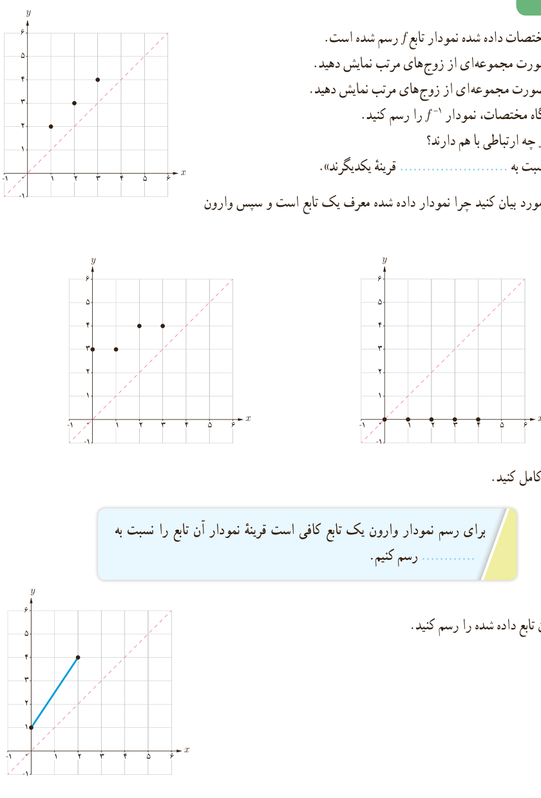

## فعالیت

۱. در دستگاه مختصات داده شده نمودار تابع $f$ رسم شده است.

الف) تابع $f$ را به‌صورت مجموعه‌ای از زوج‌های مرتب نمایش دهید.

ب) تابع $f^{-1}$ را به‌صورت مجموعه‌ای از زوج‌های مرتب نمایش دهید.

پ) در همین دستگاه مختصات، نمودار $f^{-1}$ را رسم کنید.

ت) نمودار $f$ و $f^{-1}$ چه ارتباطی با هم دارند؟ «نمودار $f$ و $f^{-1}$ نسبت به .... قرینۀ یکدیگرند».

۲. الف) در هر مورد بیان کنید چرا نمودار داده شده معرف یک تابع است و سپس وارون آن را رسم کنید.

ب) عبارت زیر را کامل کنید: برای رسم نمودار وارون یک تابع کافی است قرینۀ نمودار آن تابع را نسبت به .... رسم کنیم.

۳. نمودار وارون تابع داده شده را رسم کنید.

