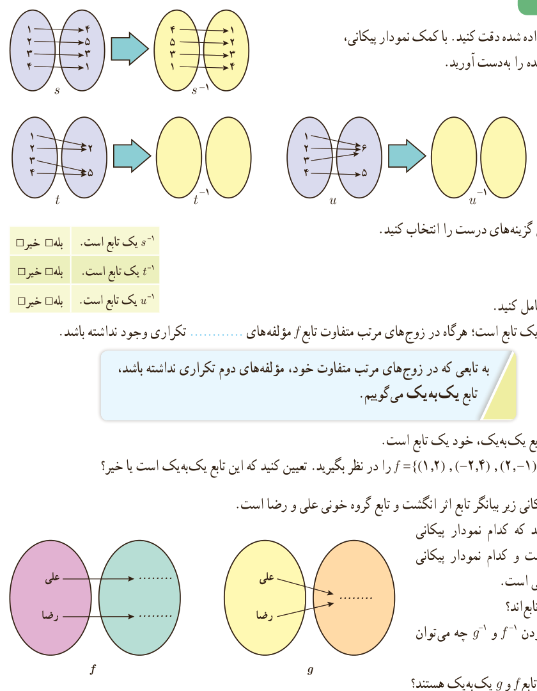

## تابع یک به یک
### فعالیت

۱. الف) به نمونۀ داده شده دقت کنید. با کمک نمودار پیکانی، وارون توابع داده شده را به‌دست آورید.

ب) در جدول مقابل گزینه‌های درست را انتخاب کنید.

| عبارت | بله | خیر |
|---|---|---|
| $s^{-1}$ یک تابع است. | □ | □ |
| $t^{-1}$ یک تابع است. | □ | □ |
| $u^{-1}$ یک تابع است. | □ | □ |

پ) عبارت زیر را کامل کنید: وارون تابع $f$، خود یک تابع است؛ هرگاه در زوج‌های مرتب متفاوت تابع $f$ مؤلفه‌های .... تکراری وجود نداشته باشد.

به تابعی که در زوج‌های مرتب متفاوت خود، مؤلفه‌های دوم تکراری نداشته باشد، تابع یک‌به‌یک می‌گوییم.

تذکر: وارون هر تابع یک‌به‌یک، خود یک تابع است.

ت) تابع $f=\{(1,2),(-2,4),(2,-1),(-1,2)\}$ را در نظر بگیرید. تعیین کنید که این تابع یک‌به‌یک است یا خیر؟

۲. نمودارهای پیکانی زیر بیانگر تابع اثر انگشت و تابع گروه خونی علی و رضا است.

الف) مشخص کنید که کدام نمودار پیکانی مربوط به اثر انگشت و کدام نمودار پیکانی مربوط به گروه خونی است.

ب) آیا $f$ و $g$ هر دو تابع‌اند؟

پ) در مورد تابع بودن $f^{-1}$ و $g^{-1}$ چه می‌توان گفت؟

ت) کدام‌یک از دو تابع $f$ و $g$ یک‌به‌یک هستند؟

ث) عبارت‌های زیر را کامل کنید.

با دانستن گروه خونی یک انسان، هویت او به‌طور یکتا تعیین .... .

با دانستن اثر انگشت یک انسان، هویت او به‌طور یکتا تعیین .... .

