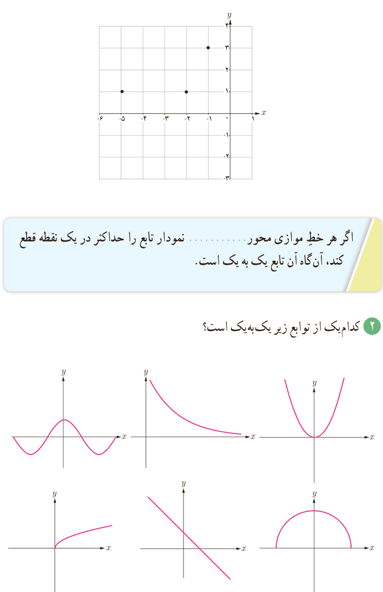

## فعالیت

۱. در شکل داده شده، با وصل کردن نقاط مشخص شده به هم، نموداری رسم کنید که تابع باشد.

الف) آیا تابعی که رسم کرده‌اید یک‌به‌یک است؟

ب) با کامل کردن عبارت زیر مشخص کنید که چگونه با در دست داشتن نمودار یک تابع، می‌توان تشخیص داد که آیا آن تابع یک به یک است یا خیر؟

اگر هر خط موازی محور .... نمودار تابع را حداکثر در یک نقطه قطع کند، آن‌گاه آن تابع یک به یک است.

۲. کدام‌یک از توابع زیر یک‌به‌یک است؟

## خواندنی

قرن‌ها پیش رشیدالدین فضل‌الله همدانی، طبیب و مورخ برجستۀ ایرانی در کتاب جامع‌التواریخ به رسم چینی‌ها در شناسایی افراد از طریق اثر انگشت اشاره کرده و توضیح داده بود که «شواهد و تجربیات نشان می‌دهد که اثر انگشت هیچ دو نفری کاملاً یکسان نیست». در آن زمان در ایران نیز از اثر انگشت شست برای مهر کردن اسناد استفاده می‌کردند. در اوایل قرن بیستم، غربی‌ها نیز با الهام گرفتن از شرقی‌ها برای شناسایی در تحقیقات جنایی از اثر انگشت بهره گرفتند. امروزه تشخیص اثر انگشت به عنوان یکی از دقیق‌ترین و سریع‌ترین روش بیومتریک در حفظ امنیت سیستم‌های کنترل دسترسی و همچنین در ساعت‌های حضور و غیاب، کاربرد بسیاری دارد.
