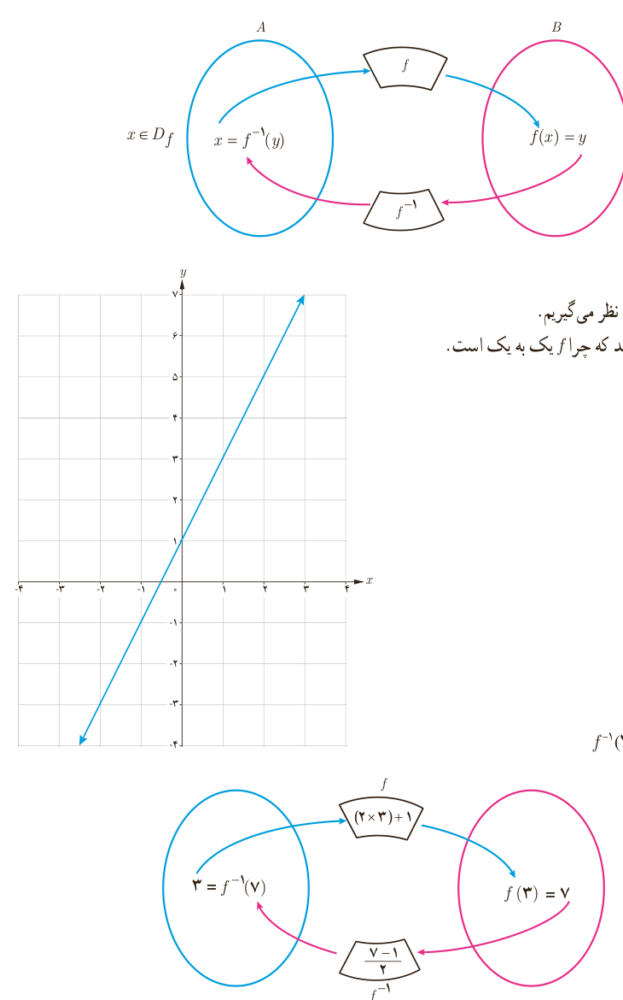

## به‌دست آوردن ضابطۀ تابع وارون یک تابع خطی غیر ثابت

اگر $f$ تابعی یک به یک باشد و $f^{-1}$ تابع وارون آن باشد، نمودار زیر ارتباط $f$ و $f^{-1}$ را نشان می‌دهد. ($R_f$ نماد برد تابع $f$ است.)

## فعالیت

تابع با ضابطۀ $f(x)=2x+1$ را در نظر می‌گیریم.

الف) به کمک نمودار $f$ توضیح دهید که چرا $f$ یک به یک است.

ب) نمودار زیر را توضیح دهید:

$$(3,7)\in f\quad\text{و}\quad(7,3)\in f^{-1}$$

به عبارت دیگر $f(3)=7$ و $f^{-1}(7)=3$.

