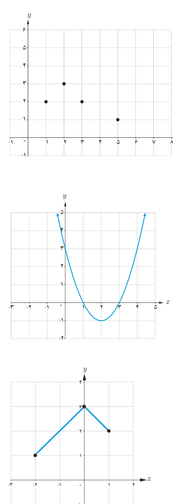

ب) $g(x)=4x$؛ پ) $u(x)=2x+3$؛ ت) $v(x)=\frac23x-4$.

۲. الف) چرا نمودار داده شده، نمودار یک تابع یک‌به‌یک نیست؟

ب) با حذف تنها یک نقطه، نمودار مقابل را به یک تابع یک‌به‌یک تبدیل کنید. مسئله چند جواب دارد؟

## کار در کلاس

الف) به نمودار تابع با ضابطۀ $f(x)=x^2-4x+3$ در شکل مقابل، دقت کنید. با محدود کردن دامنۀ این تابع روی کدام بازه‌های زیر می‌توان یک تابع یک‌به‌یک ساخت؟

□ $[1,4)$؛ □ $[0,2]$

ب) آیا هر تابع درجۀ ۲، تابعی یک‌به‌یک است؟ چرا؟

## تمرین

۱. وارون تابع $f=\{(2,3),(-2,1),(-1,2)\}$ را به‌دست آورید.

۲. نمودار وارون تابع داده شده در شکل مقابل را رسم کنید.

