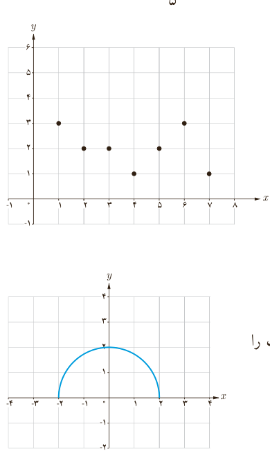

۳. ضابطۀ وارون هر یک از توابع با ضابطه‌های زیر را بیابید.

الف) $f(x)=5x-2$؛ ب) $f(x)=\frac35x+4$؛ پ) $f(x)=\frac{-7x+3}{5}$.

۴. می‌خواهیم با حذف تعدادی از نقاط نمودار مقابل، آن را به یک تابع یک‌به‌یک تبدیل کنیم. حداکثر چند نقطه می‌تواند باقی بماند؟

۵. نمودار تابعی با دامنۀ $[0,2]$ و برد $[2,5]$ را رسم کنید:

الف) به شرطی که این تابع یک‌به‌یک باشد.

ب) به شرطی که این تابع یک‌به‌یک نباشد.

۶. با حذف بخشی از نمودار نیم‌دایرۀ داده شده، نمودار یک تابع یک‌به‌یک را مشخص کنید.

مسجد جامع ورامین (تهران)

