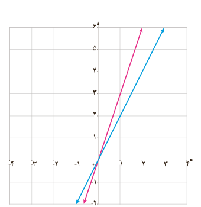

۲. برای دو تابع با ضابطه‌های $f(x)=x^2+3x+1$ و $g(x)=x-3$ جدول داده شده را کامل کنید.

| تابع | ضابطه | دامنه |
|---|---|---|
| $f+g$ | $(f+g)(x)=$ | |
| $f-g$ | $(f-g)(x)=$ | |
| $f.g$ | $(f.g)(x)=$ | |
| $f/g$ | $(f/g)(x)=$ | |

۳. برای دو تابع با ضابطه‌های $u(x)=\sqrt x+1$ و $v(x)=x-1$ جدول داده شده را کامل کنید.

| تابع | ضابطه | دامنه |
|---|---|---|
| $u+v$ | $(u+v)(x)=$ | |
| $u-v$ | $(u-v)(x)=$ | |
| $u.v$ | $(u.v)(x)=$ | |
| $u/v$ | $(u/v)(x)=$ | |

## فعالیت

مطابق شکل، دو تابع $f$ و $g$ به ترتیب با رنگ‌های قرمز و آبی نشان داده شده‌اند.

الف) ضابطۀ دو تابع $f$ و $g$ را به‌دست آورید. $f(x)=\ldots$، $g(x)=\ldots$

ب) ضابطۀ دو تابع $f+g$ و $f-g$ را به‌دست آورید. $(f+g)(x)=\ldots$، $(f-g)(x)=\ldots$

پ) با تکمیل جدول مقابل، نمودارهای توابع $f+g$ و $f-g$ را با رنگ‌های مختلف رسم کنید.

| $x$ | ۰ | ۱ |
|---|---|---|
| $f(x)$ | | |
| $g(x)$ | | |
| $(f+g)(x)$ | | |
| $(f-g)(x)$ | | |

ت) آیا جمع دو تابع خطی همیشه یک تابع خطی است؟ در مورد تفریق آنها چه می‌توان گفت؟

