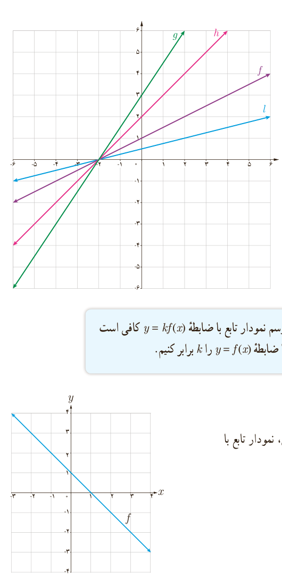

## فعالیت

با توجه به شکل دیده می‌شود که $l(x)=\frac12f(x)$. جاهای خالی را پر کنید.

$$g(x)=\ldots f(x),\qquad h(x)=\ldots f(x)$$

با توجه به نمودار فوق ملاحظه می‌شود که: اگر $k$ عددی مثبت باشد، برای رسم نمودار تابع با ضابطۀ $y=kf(x)$ کافی است عرض هر نقطه از نمودار تابع با ضابطۀ $y=f(x)$ را $k$ برابر کنیم.

## کار در کلاس

۱. با توجه به نمودار تابع با ضابطۀ $y=f(x)$ در شکل مقابل، نمودار تابع با ضابطۀ $y=-f(x)$ را رسم کنید.

۲. عبارت زیر را کامل کنید: برای رسم نمودار تابع با ضابطۀ $y=-f(x)$ کافی است قرینۀ نمودار تابع ضابطۀ $y=f(x)$ را نسبت به محور .... رسم کنیم.

