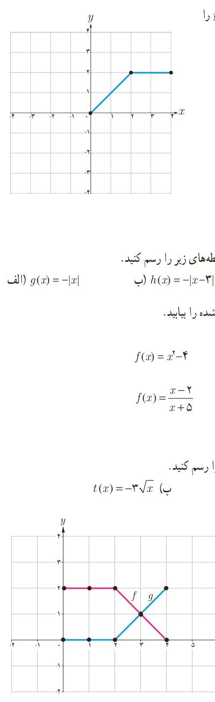

۳. در شکل روبه‌رو، نمودار تابع $f$ داده شده است. نمودار تابع با ضابطۀ $y=-2f(x)$ را رسم کنید.

## تمرین

۱. با استفاده از نمودار تابع با ضابطۀ $f(x)=|x|$، نمودار هر یک از توابع با ضابطه‌های زیر را رسم کنید.

الف) $g(x)=-|x|$؛ ب) $h(x)=-|x-3|$؛ پ) $l(x)=2|x-2|$.

۲. در هر مورد، دامنه و ضابطۀ حاصل جمع، ضرب، تقسیم و تفریق دو تابع داده شده را بیابید.

الف) $g(x)=\frac1x$، $f(x)=|x|$؛ ب) $g(x)=x+2$، $f(x)=x^2-4$؛ پ) $g(x)=-\sqrt x$، $f(x)=\sqrt x$؛ ت) $g(x)=x^2+3x-10$، $f(x)=\frac{x-2}{x+5}$؛ ث) $g=\{(-1,2),(0,3),(2,4),(3,0)\}$، $f=\{(2,5),(3,4),(0,-2)\}$.

۳. با استفاده از نمودار تابع با ضابطۀ $f(x)=\sqrt x$، هر یک از نمودارهای زیر را رسم کنید.

الف) $r(x)=2\sqrt x$؛ ب) $s(x)=-\sqrt{x-2}$؛ پ) $t(x)=-3\sqrt x$؛ ت) $u(x)=1-\sqrt x$؛ ث) $v(x)=1-\sqrt{x-3}$.

۴. در شکل مقابل، نمودار دو تابع $f$ و $g$ رسم شده است. نمودار حاصل جمع این دو تابع را به‌دست آورید.

