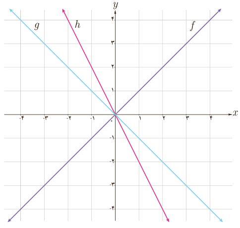
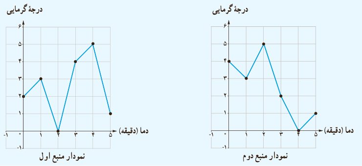

# فصل ۳ | تابع

۵) با توجه به نمودار سه تابع داده شده، مشخص کنید کدام یک از آنها برابر مجموع دو تابع دیگر است؟

## خواندنی

یک اجاق دارای دو منبع گرمایی قابل تنظیم است که می‌توانند هم‌زمان، به‌طور مستقل و جدا از هم گرما تولید کنند. نمودار دمایی که این دو منبع گرمایی تولید می‌کنند، به‌صورت زیر است. این نمودارها نشان می‌دهد که در عرض ۵ دقیقه، چگونه مقدار دما افزایش و یا کاهش می‌یابد. با توجه به نمودارهای زیر بیشترین و کمترین دمایی که در این اجاق تولید می‌شود چه مقدار است؟

۷۰
