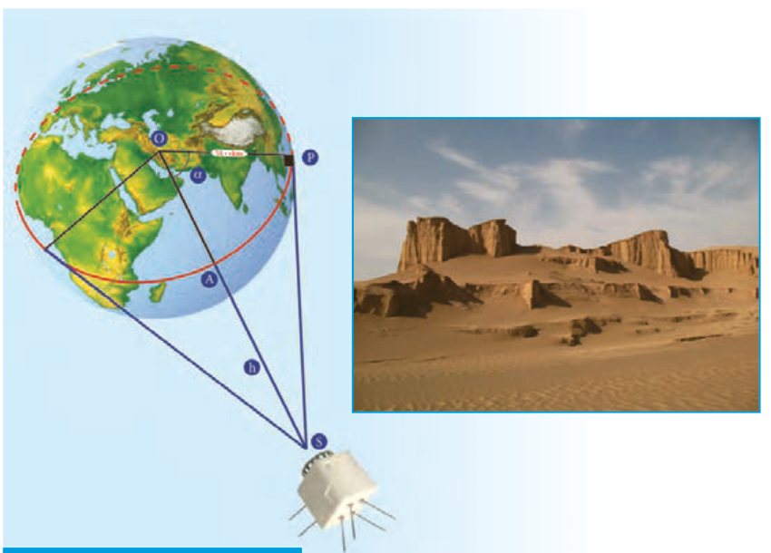

# فصل ۴ | مثلثات

ماهواره امید اولین ماهواره ساخت ایران است که در بهمن ماه ۱۳۸۷ در مدار فضا قرار گرفت. در شکل بالا این ماهواره در $h$ کیلومتری سطح زمین قرار دارد و در مدار خودش حول خط استوا حرکت می‌کند. اگر $\alpha$ زاویه بین مرکز زمین (نقطه $O$) تا ماهواره $S$ و دوردست‌ترین نقطه قابل دید روی کره زمین (نقطه $P$) تا این ماهواره باشد و شعاع تقریبی کره زمین ۶۴۰۰ کیلومتر باشد آنگاه

$$\cos\alpha=\frac{6400}{6400+h}\quad و \quad \widehat{PA}=6400\times\alpha\quad (بر حسب رادیان)$$

- درس اول: واحدهای اندازه‌گیری زاویه
- درس دوم: روابط تکمیلی بین نسبت‌های مثلثاتی
- درس سوم: توابع مثلثاتی
