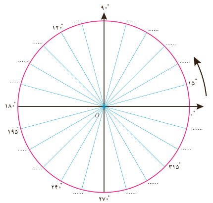
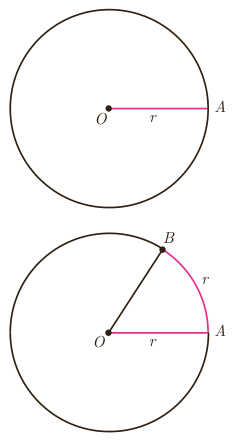

# فصل ۴ | مثلثات
## درس اول: واحدهای اندازه‌گیری زاویه

### یادآوری

- اگر محیط دایره‌ای را به ۳۶۰ کمان مساوی تقسیم کنیم، اندازه زاویه مرکزی روبه‌روی هر کدام از این کمان‌ها ۱ درجه است. اندازه هر کمان با زاویه مرکزی روبه‌روی آن کمان برحسب درجه برابر است.
- دایره مثلثاتی دایره‌ای است به شعاع واحد که جهت مثبت آن برخلاف گردش عقربه‌های ساعت است. به این جهت، جهت مثلثاتی می‌گوییم. معمولاً مرکز این دایره مبدأ مختصات است.

شکل مقابل یک دایره مثلثاتی را نمایش می‌دهد که به ۲۴ قسمت مساوی تقسیم شده است. در جاهای خالی زاویه مناسب را روی شکل مشخص کنید.

برای اندازه‌گیری زاویه، واحد دیگری وجود دارد که در ادامه با آن آشنا می‌شوید.

در فعالیت زیر رابطه بین اندازه زاویه مرکزی روبه‌رو به یک کمان و طول کمان روبه‌روی آن مشخص می‌شود.

### فعالیت

۱) یک شیء دایره‌ای شکل انتخاب کنید و نخی را دور آن بپیچید و سپس باز کنید؛ طول نخ را با خط‌کش اندازه بگیرید. طول این نخ چه کمیتی از دایره را مشخص می‌کند؟ با استفاده از این مقدار شعاع دایره را به‌دست آورید.

۲) قطعه نخی را به اندازه شعاع دایره برش دهید و آن را از نقطه $A$ روی آن دایره قرار دهید تا نقطه $B$ حاصل شود (شکل مقابل). اندازه $\angle AOB$ را با نقاله اندازه‌گیری کنید. این زاویه تقریباً چند درجه است؟

۷۲
