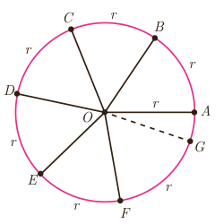
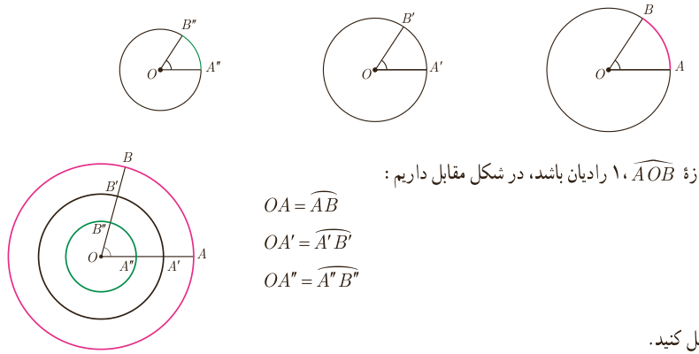
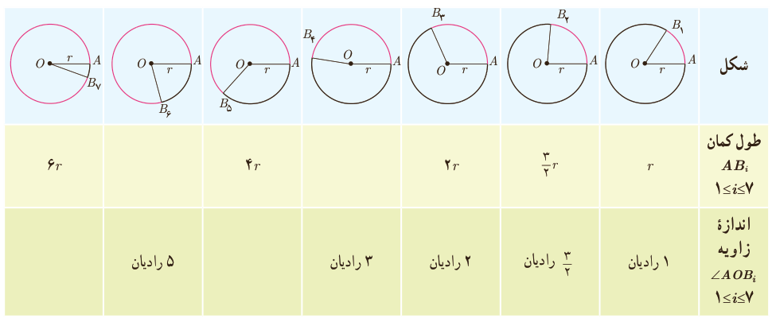

# درس اول | واحدهای اندازه‌گیری زاویه

۳) دوباره این قطعه نخ را از نقطه $B$ روی دایره قرار دهید تا نقطه $C$ حاصل شود و این کار را ادامه دهید تا نقاط $D$، $E$، $F$ و $G$ روی دایره به دست آیند (شکل مقابل). در این حالت $\angle BOC$، $\angle COD$، $\angle DOE$، $\angle EOF$ و $\angle FOG$ با زاویه ........ برابر و هر یک تقریباً ........ درجه است. آیا دو نقطه $G$ و $A$ بر هم منطبق می‌شوند؟

به این ترتیب ۶ زاویه مرکزی حاصل می‌شود که طول کمان روبه‌روی هر یک از آنها با ........ دایره برابر است. به هر یک از این زاویه‌ها یک رادیان می‌گوییم.

**۱ رادیان** برابر است با اندازه زاویه مرکزی روبه‌رو به کمانی از دایره به طول شعاع دایره.

در تمام دایره‌های زیر اندازه زاویه مشخص شده ۱ رادیان است. در هر کدام با استفاده از نقاله اندازه زاویه را برحسب درجه مشخص کنید.

به عبارت دیگر اگر اندازه $\angle AOB$، ۱ رادیان باشد، در شکل مقابل داریم:

$$OA=\widehat{AB},\qquad OA'=\widehat{A'B'},\qquad OA''=\widehat{A''B''}$$

۴) جدول زیر را کامل کنید.

| شکل | $B_1$ | $B_2$ | $B_3$ | $B_4$ | $B_5$ | $B_6$ | $B_7$ |
|---|---|---|---|---|---|---|---|
| طول کمان $\widehat{AB_i}$، $1\leq i\leq7$ | $r$ | $\frac32r$ | $2r$ |  | $4r$ |  | $6r$ |
| اندازه زاویه $\angle AOB_i$، $1\leq i\leq7$ | ۱ رادیان | $\frac32$ رادیان | ۲ رادیان | ۳ رادیان |  | ۵ رادیان |  |

۷۳
