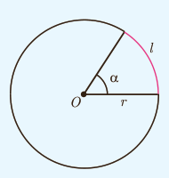

# فصل ۴ | مثلثات

همان‌طور که می‌بینید در هر ستون با تقسیم طول کمان به اندازه شعاع دایره ($r$)، اندازه زاویه مرکزی مربوط به آن برحسب رادیان به‌دست می‌آید. با توجه به جدول صفحه قبل می‌توان گفت:

$$\text{اندازه یک زاویه برحسب رادیان}=\frac{\text{طول کمان روبه‌روی زاویه}}{\text{اندازه شعاع دایره}}$$

اگر $l$ طول کمان روبه‌روی زاویه، $r$ اندازه شعاع دایره و $\alpha$ اندازه زاویه برحسب رادیان باشد، آنگاه رابطه بالا را به صورت زیر می‌توان نوشت:

$$\alpha=\frac{l}{r}$$

در رابطه بالا $l$ و $r$ هم واحدند.

### کار در کلاس

با استفاده از رابطه بالا جدول زیر را کامل کنید:

| $l$ |  | ۱۰ متر | ۵۰ متر | ۹۰ سانتی‌متر | ۲۰۰ سانتی‌متر |  | ۵۰۰ سانتی‌متر |  |
|---|---|---|---|---|---|---|---|---|
| $r$ | ۲۰ سانتی‌متر |  | ۱۰ متر |  | ۱ متر | ۰٫۵ متر | ۵ متر | ۵ سانتی‌متر |
| $\alpha$ | ۲۰ رادیان | ۱۰ رادیان |  | ۳ رادیان |  | ۱٫۵ رادیان |  | ۱ رادیان |

### یادآوری

می‌دانیم نسبت محیط هر دایره به اندازه قطر آن عددی ثابت است که آن را با $\pi$ نمایش می‌دهند و به آن عدد پی می‌گویند. مقدار تقریبی این عدد ۳٫۱۴ است. حال جدول زیر را کامل کنید:

| زاویه برحسب رادیان | $\pi$ رادیان | ۳٫۱۴ رادیان | ۳ رادیان | ۲ رادیان | ۱ رادیان | ۰٫۵ رادیان |
|---|---|---|---|---|---|---|
| زاویه برحسب درجه | دقیقاً $180^\circ$ | تقریباً ... | تقریباً ... | تقریباً ... | تقریباً $57^\circ$ | تقریباً ... |

بنابراین، اندازه زاویه مرکزی روبه‌رو به کمان نیم دایره برابر است با ........ درجه یا ........ رادیان. به عبارت دیگر اندازه زاویه نیم صفحه برابر است با ........ رادیان. در نتیجه:

$$\text{یک درجه}=\frac{\pi}{180}\text{ رادیان}$$

۷۴
