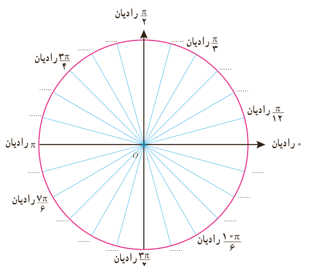
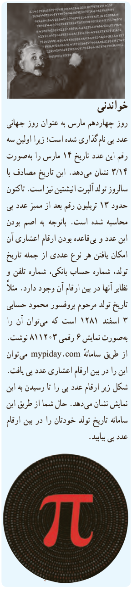

# درس اول | واحدهای اندازه‌گیری زاویه

به این ترتیب:

$$180^\circ=\pi\text{ رادیان}$$

با تقسیم بر ۲: $90^\circ=\ldots$ رادیان؛ با تقسیم بر ۳: $\ldots=\frac{\pi}{3}$؛ با تقسیم بر ۴: $\ldots=\ldots$ رادیان؛ با تقسیم بر ۶: $30^\circ=\ldots$ رادیان.

### کار در کلاس

۱) مطابق نمونه هر یک از زاویه‌ها را از درجه به رادیان تبدیل کنید:

$$30^\circ\longrightarrow\frac{\pi}{6}\text{ رادیان}\qquad 45^\circ\longrightarrow\ldots\qquad 90^\circ\longrightarrow\ldots$$
$$36^\circ\longrightarrow\ldots\qquad 60^\circ\longrightarrow\ldots\qquad 180^\circ\longrightarrow\ldots$$

اگر $D$ اندازه زاویه $\alpha$ برحسب درجه و $R$ اندازه زاویه $\alpha$ برحسب رادیان باشد، آنگاه:

$$\frac{D}{180^\circ}=\frac{R}{\pi\text{ رادیان}}$$

۲) حال جدول زیر را با استفاده از این رابطه کامل کنید:

| $D$ (درجه) | $5^\circ$ |  | $24^\circ$ |  | $120^\circ$ |  |
|---|---|---|---|---|---|---|
| $R$ (رادیان) | $\frac{\pi}{36}$ | $\frac{\pi}{7}$ |  | $\frac{2\pi}{5}$ |  | $\frac{5\pi}{4}$ |

۳) در شکل زیر در هر یک از جاهای خالی زاویه مناسب را برحسب رادیان مشخص کنید.

### خواندنی

روز چهاردهم مارس به عنوان روز جهانی عدد پی نام‌گذاری شده است؛ زیرا اولین سه رقم این عدد تاریخ ۱۴ مارس را به‌صورت ۳٫۱۴ نشان می‌دهد. این تاریخ مصادف با سالروز تولد آلبرت اینشتین نیز است. تاکنون حدود ۱۳ تریلیون رقم بعد از ممیز عدد پی محاسبه شده است. باتوجه به اصم بودن این عدد و بی‌قاعده بودن ارقام اعشاری آن امکان یافتن هر نوع عددی از جمله تاریخ تولد، شماره حساب بانکی، شماره تلفن و نظایر آنها در بین ارقام آن وجود دارد. مثلاً تاریخ تولد مرحوم پروفسور محمود حسابی ۳ اسفند ۱۲۸۱ است که می‌توان آن را به‌صورت نمایش ۶ رقمی ۸۱۱۲۰۳ نوشت. از طریق سامانه mypiday.com می‌توان این را در بین ارقام اعشاری عدد پی یافت. شکل زیر ارقام عدد پی را تا رسیدن به این نمایش نشان می‌دهد. حال شما از طریق این سامانه تاریخ تولد خودتان را در بین ارقام عدد پی بیابید.

۷۵
