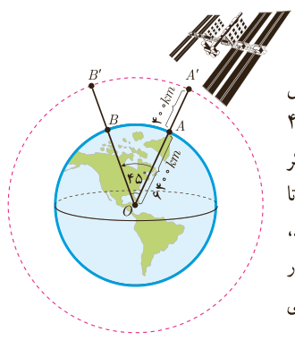

# فصل ۴ | مثلثات

### فعالیت

ایستگاه فضایی بین‌المللی را مطابق شکل مقابل در نظر بگیرید که در فاصله تقریبی ۴۰۰ کیلومتری بالای سطح کره زمین قرار دارد. اگر این ایستگاه توسط ایستگاه زمینی از نقطه $A$ تا نقطه $B$ که با مرکز زمین زاویه $45^\circ$ می‌سازند، رصد شود، این ایستگاه چه مسافتی را در مدار خود از $A'$ به $B'$ پوشش می‌دهد؟ شعاع تقریبی کره زمین را ۶۴۰۰ کیلومتر فرض کنید.

۱) ابتدا زاویه مرکزی $45^\circ$ را به رادیان تبدیل کنید.

$$\alpha=45^\circ\times\ldots=\frac{\pi}{4}\text{ رادیان}$$

۲) شعاع مدار دایره‌ای شکل که ایستگاه فضایی روی آن قرار دارد، برابر است با $r=\ldots$.

۳) طول کمان روبه‌روی $\angle A'OB'$ با فرض $\pi\simeq3.14$ و با استفاده از رابطه $\alpha=l/r$ به طور تقریبی برابر است با:

$$l=\frac{\pi}{4}\times\ldots\simeq5338\,km$$

### تمرین

۱) هر یک از زاویه‌های $-12^\circ$، $36^\circ$، $72^\circ$، $-105^\circ$ و $315^\circ$ را به رادیان تبدیل کنید و روی دایره مثلثاتی نشان دهید.

۲) هر یک از زاویه‌های $-\frac{\pi}{18}$، $-\frac{2\pi}{5}$، $\frac{3\pi}{4}$، $\frac{7\pi}{8}$، $\frac{6\pi}{5}$ رادیان را به درجه تبدیل کنید و به‌طور تقریبی روی دایره مثلثاتی نشان دهید.

۳) زاویه $D$ برابر با $\frac{\pi}{20}$ رادیان است. اندازه این زاویه چند درجه است؟

۴) دایره‌ای به شعاع ۱۰ سانتی‌متر مفروض است. اندازه زاویه مرکزی مقابل به کمانی به طول ۸ سانتی‌متر از این دایره چند رادیان است؟

۵) درستی یا نادرستی هر یک از جملات زیر را با ذکر دلیل بررسی کنید.

الف) اگر زاویه بین دو ساق مثلث متساوی‌الساقینی ۱ رادیان باشد، آنگاه اندازه قاعده این مثلث کوچک‌تر از اندازه هر یک از ساق‌های آن است.

ب) در دایره‌ای به شعاع ۱ سانتی‌متر طول کمان روبه‌روی زاویه $\pi$ رادیان تقریباً برابر با ۳٫۱۴ سانتی‌متر است.

پ) انتهای کمان زاویه $\frac{6\pi}{5}$ رادیان در ربع دوم دایره مثلثاتی قرار دارد.

ت) زاویه‌های $\frac{2\pi}{3}$ رادیان، $\frac{\pi}{9}$ رادیان، $\frac{7\pi}{36}$ رادیان، زوایای یک مثلث را تشکیل می‌دهند.

### خواندنی

یک زاویه برحسب رادیان را با استفاده از ماشین حساب می‌توان به طور تقریبی برحسب درجه محاسبه کرد. در اغلب ماشین حساب‌ها دکمه‌ای با نماد $\pi$ وجود دارد. مثلاً برای محاسبه ۱ رادیان کافی است حاصل $1\times\frac{180^\circ}{\pi}$ را به‌دست آوریم که تقریباً برابر با $57.3^\circ$ است.

حال، شما مقدار تقریبی زاویه‌های زیر را مشابه نمونه با ماشین حساب به دست آورید: ۰٫۵، $\frac45$، ۲، ۳، ۳٫۱۴، $\frac\pi3$، $\frac\pi4$ و $\pi$ رادیان.

۷۶
