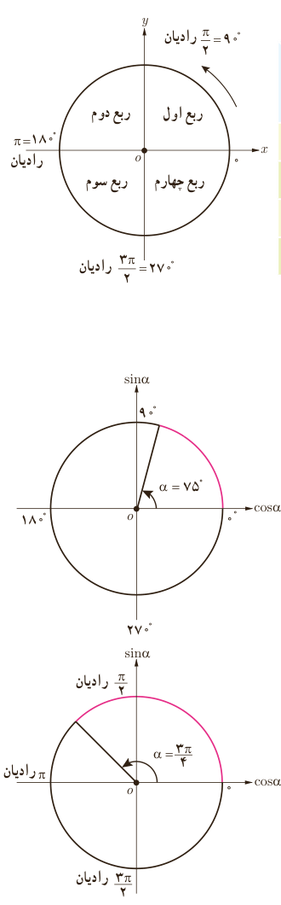

# درس دوم | روابط تکمیلی بین نسبت‌های مثلثاتی

در شکل مقابل، یک دایره مثلثاتی با چهار ربع آن مشخص شده است. جدول زیر علامت چهار نسبت مثلثاتی در هر ربع را نشان می‌دهد.

| نسبت مثلثاتی | اول: $0<\alpha<\frac\pi2$ | دوم: $\frac\pi2<\alpha<\pi$ | سوم: $\pi<\alpha<\frac{3\pi}2$ | چهارم: $\frac{3\pi}2<\alpha<2\pi$ |
|---|---|---|---|---|
| $\sin\alpha$ | + | + | − | − |
| $\cos\alpha$ | + | − | − | + |
| $\tan\alpha$ | + | − | + | − |
| $\cot\alpha$ | + | − | + | − |

### فعالیت

۱) جداول زیر را مطابق نمونه کامل کنید.

| زاویه $\alpha$ | انتهای کمان روبه‌روی $\alpha$ | علامت نسبت مثلثاتی |
|---|---|---|
| $75^\circ$ | ربع اول | $\tan\alpha>0$ |
| $150^\circ$ |  | $\sin\alpha$ |
| $210^\circ$ |  | $\cos\alpha$ |
| $240^\circ$ |  | $\cot\alpha$ |
| $285^\circ$ |  | $\tan\alpha$ |

| زاویه $\alpha$ | انتهای کمان روبه‌روی $\alpha$ | علامت نسبت مثلثاتی |
|---|---|---|
| $\frac{3\pi}{4}$ رادیان | ربع دوم | $\cos\alpha<0$ |
| $\frac{4\pi}{5}$ رادیان |  | $\sin\alpha$ |
| $\frac{5\pi}{3}$ رادیان |  | $\tan\alpha$ |
| $\frac{5\pi}{12}$ رادیان |  | $\cos\alpha$ |
| $\frac{5\pi}{4}$ رادیان |  | $\cot\alpha$ |

۷۷
