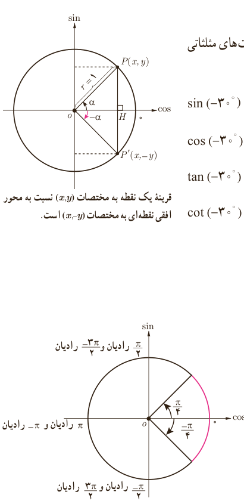

# درس دوم | روابط تکمیلی بین نسبت‌های مثلثاتی

۳) حاصل عبارت‌های زیر را به دست آورید.

الف) $\cot\frac\pi6-\tan\frac\pi3\times\sin\frac\pi4=$

ب) $\displaystyle\frac{\tan^2(\frac\pi6)+\sin^2(\frac\pi4)}{\cot^2(\frac\pi4)-\cos^2(\frac\pi3)}+\cos^275^\circ+\sin^275^\circ=$

در ادامه می‌خواهیم ببینیم نسبت‌های مثلثاتی زاویه‌های قرینه، متمم و مکمل با هم چه ارتباطی دارند.

## نسبت‌های مثلثاتی زاویه‌های قرینه

### فعالیت

دو زاویه $\alpha$ و $-\alpha$ را قرینه یکدیگر می‌گویند. اگر در شکل مقابل $\alpha=30^\circ$، نسبت‌های مثلثاتی زاویه $-30^\circ$ در $\triangle OP'H$ عبارت‌اند از:

$$\sin(-30^\circ)=\frac{-y}{r}=-\sin30^\circ=-\frac12$$
$$\cos(-30^\circ)=\ldots=\ldots=\frac{\sqrt3}2$$
$$\tan(-30^\circ)=\frac{-y}{x}=\ldots=\ldots$$
$$\cot(-30^\circ)=\ldots=\ldots=\ldots$$

قرینه یک نقطه به مختصات $(x,y)$ نسبت به محور افقی نقطه‌ای به مختصات $(x,-y)$ است.

در حالت کلی:

$$\sin(-\alpha)=-\sin\alpha,\quad\cos(-\alpha)=\cos\alpha$$
$$\tan(-\alpha)=-\tan\alpha,\quad\cot(-\alpha)=-\cot\alpha$$

### کار در کلاس

۱) سایر نسبت‌های مثلثاتی زاویه $-\frac\pi4$ رادیان را مطابق نمونه به دست آورید.

$$\sin(-\frac\pi4)=-\sin\frac\pi4$$

۷۹
