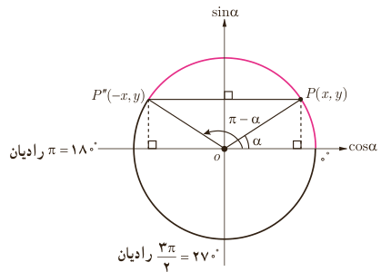

# فصل ۴ | مثلثات

۲) حاصل هر یک از عبارت‌های زیر را مطابق نمونه به دست آورید.

$$\cot(-\frac\pi3)\times\cos(-\frac\pi6)+\tan(-\frac\pi4)=-\cot\frac\pi3\times\cos\frac\pi6-\tan\frac\pi4=-\frac{\sqrt3}3\times\frac{\sqrt3}2-1=-\frac32$$

الف) $\displaystyle\frac{\cos(-90^\circ)+\sin(-270^\circ)}{\sin(-180^\circ)-\cos(-360^\circ)}=\frac{\ldots}{\ldots}=\ldots$

ب) $\cot(-\frac\pi6)+\tan(-\frac\pi3)=\ldots$

پ) $\cos(-45^\circ)\times\cos(-60^\circ)+\sin(-45^\circ)\times\sin(-60^\circ)=\ldots+\ldots=\ldots$

## نسبت‌های مثلثاتی زاویه‌های مکمل

### فعالیت

دو زاویه $\alpha$ و $\beta$ را مکمل گوییم؛ هرگاه مجموع آنها $180^\circ$ یا $\pi$ رادیان شود. مثلاً دو زاویه $30^\circ$ و $150^\circ$ مکمل یکدیگرند. همچنین دو زاویه $\frac\pi3$ رادیان و $\frac{2\pi}3$ رادیان مکمل یکدیگرند (چرا؟). در دایره مثلثاتی زیر اگر $\alpha=30^\circ$ آنگاه با توجه به مختصات نقطه $P''$ و انتهای کمان زاویه $150^\circ$ که در ربع دوم واقع است، نسبت‌های مثلثاتی زاویه $150^\circ$ عبارت‌اند از:

$$\sin150^\circ=\sin(180^\circ-30^\circ)=y=\sin30^\circ=\frac12$$
$$\cos150^\circ=\cos(180^\circ-30^\circ)=-x=-\cos30^\circ=-\frac{\sqrt3}2$$
$$\tan150^\circ=\ldots=\ldots\qquad\cot150^\circ=\ldots=\ldots$$

قرینه یک نقطه به مختصات $(x,y)$ نسبت به محور عمودی نقطه‌ای به مختصات $(-x,y)$ است.

در حالت کلی:

$$\sin(\pi-\alpha)=\sin\alpha,\quad\cos(\pi-\alpha)=-\cos\alpha$$
$$\tan(\pi-\alpha)=-\tan\alpha,\quad\cot(\pi-\alpha)=-\cot\alpha$$

### کار در کلاس

۱) مکمل هر یک از زاویه‌های زیر را مشخص کنید: الف) $75^\circ$، ب) $-25^\circ$، پ) $\frac\pi{12}$ رادیان، ت) $-\frac\pi4$ رادیان.

۸۰
