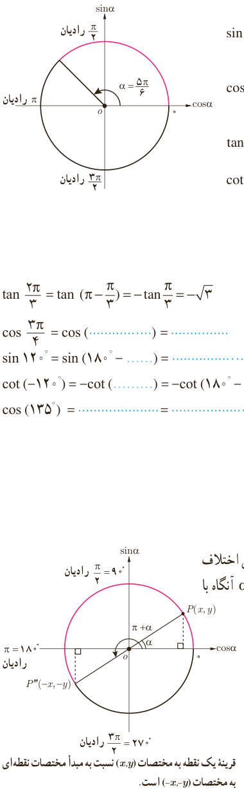

# درس دوم | روابط تکمیلی بین نسبت‌های مثلثاتی

۲) نسبت‌های مثلثاتی زاویه $\frac{5\pi}6$ رادیان را مطابق نمونه به‌دست آورید.

$$\sin\frac{5\pi}6=\sin(\pi-\frac\pi6)=\sin\frac\pi6=\frac12$$
$$\cos\frac{5\pi}6=\ldots\qquad\tan\frac{5\pi}6=\ldots\qquad\cot\frac{5\pi}6=\ldots$$

### فعالیت

حاصل هر یک از نسبت‌های مثلثاتی زیر را مطابق نمونه به دست آورید.

$$\tan\frac{2\pi}3=\tan(\pi-\frac\pi3)=-\tan\frac\pi3=-\sqrt3$$
$$\cos\frac{3\pi}4=\cos(\ldots)=\ldots$$
$$\sin120^\circ=\sin(180^\circ-\ldots)=\ldots=\ldots$$
$$\cot(-120^\circ)=-\cot(\ldots)=-\cot(180^\circ-\ldots)=\ldots$$
$$\cos(135^\circ)=\ldots=\ldots=\ldots$$

## نسبت‌های مثلثاتی دو زاویه با اختلاف $\pi$ رادیان

### فعالیت

نسبت‌های مثلثاتی زاویه $210^\circ$ را به دست آورید.

انتهای کمان زاویه $210^\circ$ در ربع سوم واقع است. در ضمن $210^\circ=180^\circ+30^\circ$، یعنی اختلاف دو زاویه $210^\circ$ و $30^\circ$ برابر با $\pi$ رادیان است. در دایره مثلثاتی مقابل، اگر $\alpha=30^\circ$ آنگاه با توجه به مختصات نقطه $P'''$، نسبت‌های مثلثاتی زاویه $210^\circ$ عبارت‌اند از:

$$\sin210^\circ=\sin(180^\circ+30^\circ)=-y=-\sin30^\circ=-\frac12$$
$$\cos210^\circ=\ldots=-x=\ldots$$
$$\tan210^\circ=\frac{\sin210^\circ}{\cos210^\circ}=\ldots\qquad\cot210^\circ=\ldots=\ldots$$

قرینه یک نقطه به مختصات $(x,y)$ نسبت به مبدأ مختصات نقطه‌ای به مختصات $(-x,-y)$ است.

۸۱
