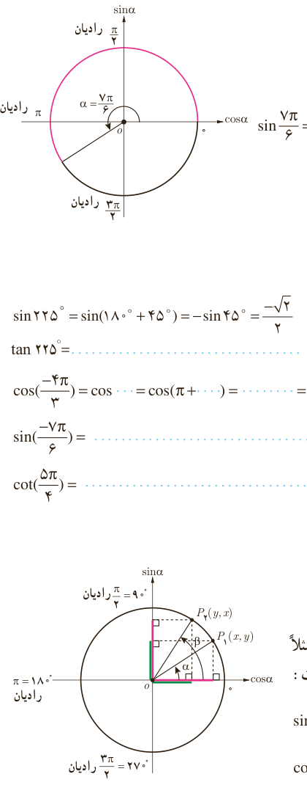

# فصل ۴ | مثلثات

در حالت کلی:

$$\sin(\pi+\alpha)=-\sin\alpha,\quad\cos(\pi+\alpha)=-\cos\alpha$$
$$\tan(\pi+\alpha)=\tan\alpha,\quad\cot(\pi+\alpha)=\cot\alpha$$

### کار در کلاس

سایر نسبت‌های مثلثاتی زاویه $\frac{7\pi}6$ رادیان را مطابق نمونه مشخص کنید.

$$\sin\frac{7\pi}6=\sin(\pi+\frac\pi6)=-\sin\frac\pi6=-\frac12$$

### فعالیت

حاصل هر یک از نسبت‌های مثلثاتی زیر را مطابق نمونه بیابید.

$$\sin225^\circ=\sin(180^\circ+45^\circ)=-\sin45^\circ=-\frac{\sqrt2}2$$
$$\tan225^\circ=\ldots$$
$$\cos(-\frac{4\pi}3)=\cos\ldots=\cos(\pi+\ldots)=\ldots=\ldots$$
$$\sin(-\frac{7\pi}6)=\ldots\qquad\cot(\frac{5\pi}4)=\ldots$$

## نسبت‌های مثلثاتی زاویه‌های متمم

### فعالیت

دو زاویه $\alpha$ و $\beta$ را متمم گوییم؛ هرگاه مجموع آنها $90^\circ$ یا $\frac\pi2$ رادیان شود. مثلاً دو زاویه $\alpha=30^\circ$ و $\beta=60^\circ$ در دایره مثلثاتی مقابل متمم یکدیگرند. در این حالت:

$$\sin30^\circ=\cos60^\circ=\frac12$$
$$\cos30^\circ=\sin60^\circ=\frac{\sqrt3}2$$

۸۲
