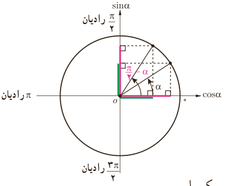

# درس دوم | روابط تکمیلی بین نسبت‌های مثلثاتی

$$\tan30^\circ=\cot60^\circ=\frac{\sqrt3}3$$
$$\cot30^\circ=\tan60^\circ=\sqrt3$$

زاویه‌ای معرفی کنید که با متمم خودش برابر باشد. برای چنین زاویه‌ای داریم:

$$\sin\ldots=\cos\ldots=\ldots\qquad\tan\ldots=\cot\ldots=\ldots$$

همچنین زاویه ........ و $\frac\pi2$ رادیان متمم یکدیگرند؛ بنابراین:

$$\sin\frac\pi2=\cos\ldots=\ldots\qquad\tan\frac\pi2=\cot\ldots=\ldots$$

در حالت کلی:

$$\sin(\frac\pi2-\alpha)=\cos\alpha,\quad\cos(\frac\pi2-\alpha)=\sin\alpha$$
$$\tan(\frac\pi2-\alpha)=\cot\alpha,\quad\cot(\frac\pi2-\alpha)=\tan\alpha$$

به عبارت دیگر: اگر دو زاویه $\alpha$ و $\beta$ متمم باشند ($\alpha+\beta=\frac\pi2$ رادیان) آنگاه سینوس یکی با کسینوس دیگری و تانژانت یکی با کتانژانت دیگری برابر است. به بیان دیگر:

$$\sin\alpha=\cos\beta,\quad\cos\alpha=\sin\beta,\quad\tan\alpha=\cot\beta,\quad\cot\alpha=\tan\beta$$

## نسبت‌های مثلثاتی دو زاویه با اختلاف $\frac\pi2$ رادیان

### فعالیت

نسبت‌های مثلثاتی زاویه $\frac{2\pi}3$ رادیان را به‌دست آورید.

چون انتهای کمان زاویه $\frac{2\pi}3$ رادیان در ربع دوم واقع است، به دو روش می‌توان نسبت‌های مثلثاتی آن را یافت.

۸۳
