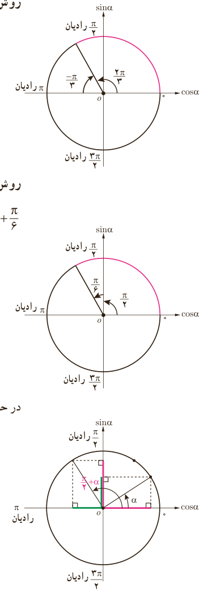

# فصل ۴ | مثلثات

**روش اول** ـ زاویه $\frac{2\pi}3$ رادیان و $\frac\pi3$ رادیان مکمل یکدیگرند؛ یعنی $\frac{2\pi}3=\pi-\frac\pi3$. بنابراین:

$$\sin\frac{2\pi}3=\sin(\pi-\frac\pi3)=\ldots=\frac{\sqrt3}2$$
$$\cos\frac{2\pi}3=\ldots=-\cos\frac\pi3=\ldots$$
$$\tan\frac{2\pi}3=\ldots=\ldots=\ldots$$
$$\cot\frac{2\pi}3=\ldots=\ldots=-\frac{\sqrt3}3$$

**روش دوم** ـ اختلاف دو زاویه $\frac{2\pi}3$ رادیان و $\frac\pi6$ رادیان برابر با $\frac\pi2$ رادیان است؛ یعنی $\frac{2\pi}3=\frac\pi2+\frac\pi6$. بنابراین با توجه به علامت نسبت‌های مثلثاتی در ربع دوم:

$$\sin\frac{2\pi}3=\sin(\frac\pi2+\frac\pi6)=\cos\frac\pi6=\frac{\sqrt3}2$$
$$\cos\frac{2\pi}3=\cos(\ldots)=-\sin\ldots=-\frac12$$
$$\tan\frac{2\pi}3=\ldots=-\cot\frac\pi6=\ldots$$
$$\cot\frac{2\pi}3=\ldots=\ldots=\ldots$$

در حالت کلی:

$$\sin(\frac\pi2+\alpha)=\cos\alpha,\quad\cos(\frac\pi2+\alpha)=-\sin\alpha$$
$$\tan(\frac\pi2+\alpha)=-\cot\alpha,\quad\cot(\frac\pi2+\alpha)=-\tan\alpha$$

### کار در کلاس

نسبت‌های مثلثاتی زاویه $135^\circ$ را به دو روش به‌دست آورید.

۸۴
