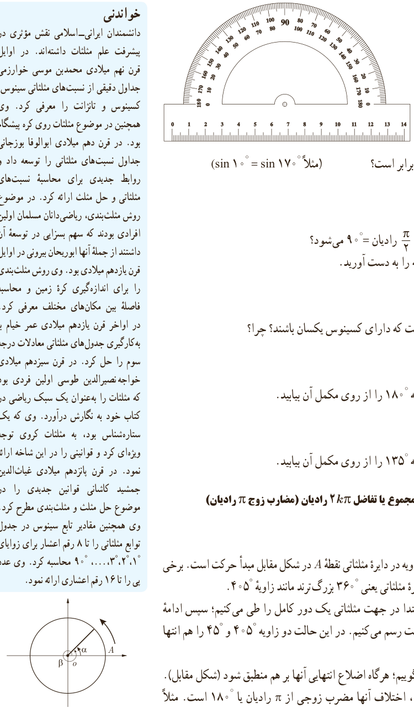

# درس دوم | روابط تکمیلی بین نسبت‌های مثلثاتی

### کار در کلاس

به کمک نقاله سؤالات زیر را پاسخ دهید:

۱) سینوس کدام دو زاویه برابر است؟ (مثلاً $\sin10^\circ=\sin170^\circ$)

۲) اختلاف کدام دو زاویه $\frac\pi2$ رادیان $=90^\circ$ می‌شود؟ نسبت‌های مثلثاتی یک نمونه را به دست آورید.

۳) آیا دو زاویه می‌توان یافت که دارای کسینوس یکسان باشند؟ چرا؟

۴) نسبت‌های مثلثاتی زاویه $180^\circ$ را از روی مکمل آن بیابید.

۵) نسبت‌های مثلثاتی زاویه $135^\circ$ را از روی مکمل آن بیابید.

## نسبت‌های مثلثاتی زوایا با مجموع یا تفاضل $2k\pi$ رادیان (مضارب زوج $\pi$ رادیان)

### فعالیت

یادآوری می‌کنیم برای رسم زاویه در دایره مثلثاتی نقطه $A$ در شکل مقابل مبدأ حرکت است. برخی از زوایا از یک دور کامل دایره مثلثاتی یعنی $360^\circ$ بزرگ‌ترند مانند زاویه $405^\circ$.

برای رسم چنین زاویه‌ای ابتدا در جهت مثلثاتی یک دور کامل را طی می‌کنیم؛ سپس ادامه زاویه را که به اندازه $45^\circ$ است رسم می‌کنیم. در این حالت دو زاویه $405^\circ$ و $45^\circ$ را هم‌انتها می‌نامیم.

دو زاویه $\alpha$ و $\beta$ را هم‌انتها گوییم؛ هرگاه اضلاع انتهایی آنها بر هم منطبق شود (شکل مقابل). اگر دو زاویه هم‌انتها باشند، اختلاف آنها مضرب زوجی از $\pi$ رادیان یا $180^\circ$ است. مثلاً

### خواندنی

دانشمندان ایرانی–اسلامی نقش مؤثری در پیشرفت علم مثلثات داشته‌اند. در اوایل قرن نهم میلادی محمدبن موسی خوارزمی جداول دقیقی از نسبت‌های مثلثاتی سینوس، کسینوس و تانژانت را معرفی کرد. وی همچنین در موضوع مثلثات روی کره پیشگام بود. در قرن دهم میلادی ابوالوفا بوزجانی جداول نسبت‌های مثلثاتی را توسعه داد و روابط جدیدی برای محاسبه نسبت‌های مثلثاتی و حل مثلث ارائه کرد. در موضوع روش مثلث‌بندی، ریاضی‌دانان مسلمان اولین افرادی بودند که سهم بسزایی در توسعه آن داشتند از جمله آنها ابوریحان بیرونی در اوایل قرن یازدهم میلادی بود. وی روش مثلث‌بندی را برای اندازه‌گیری کره زمین و محاسبه فاصله بین مکان‌های مختلف معرفی کرد. در اواخر قرن یازدهم میلادی عمر خیام با به‌کارگیری جدول‌های مثلثاتی معادلات درجه سوم را حل کرد. در قرن سیزدهم میلادی خواجه نصیرالدین طوسی اولین فردی بود که مثلثات را به‌عنوان یک سبک ریاضی در کتاب خود به نگارش درآورد. وی که یک ستاره‌شناس بود، به مثلثات کروی توجه ویژه‌ای کرد و قوانینی را در این شاخه ارائه نمود. در قرن پانزدهم میلادی غیاث‌الدین جمشید کاشانی قوانین جدیدی را در موضوع حل مثلث و مثلث‌بندی مطرح کرد. وی همچنین مقادیر تابع سینوس در جدول توابع مثلثاتی را تا ۸ رقم اعشار برای زوایای $1^\circ،2^\circ،3^\circ،\ldots،90^\circ$ محاسبه کرد. وی عدد پی را تا ۱۶ رقم اعشاری ارائه نمود.

۸۵
