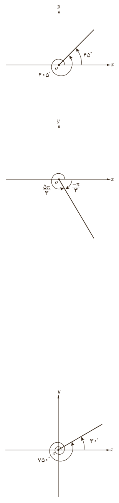

# فصل ۴ | مثلثات

زاویه‌های $405^\circ$ و $45^\circ$ هم‌انتها هستند؛ زیرا $405^\circ-45^\circ=360^\circ$ (شکل سمت راست). در این حالت نسبت‌های مثلثاتی زاویه‌های $405^\circ$ و $45^\circ$ یکسان‌اند. چون انتهای کمان زاویه $45^\circ$ در ربع اول است، بنابراین:

$$\sin405^\circ=\sin(360^\circ+45^\circ)=\sin45^\circ=\ldots$$
$$\cos405^\circ=\ldots=\ldots=\ldots$$
$$\tan405^\circ=\ldots=\ldots=\ldots$$
$$\cot405^\circ=\ldots=\ldots=\ldots$$

حال همین بررسی را روی زاویه $\frac{5\pi}3$ رادیان انجام دهید؛ چون $\frac{5\pi}3=2\pi-\ldots$ بنابراین دو زاویه ........ و $\frac{5\pi}3$ رادیان هم‌انتها هستند (شکل سمت راست).

چون انتهای کمان زاویه $\frac{5\pi}3$ رادیان در ربع چهارم است؛ بنابراین:

$$\sin\frac{5\pi}3=\sin(2\pi-\frac\pi3)=\sin(-\frac\pi3)=\ldots$$
$$\cos\frac{5\pi}3=\ldots\qquad\tan\frac{5\pi}3=\ldots\qquad\cot\frac{5\pi}3=\ldots$$

در حالت کلی برای هر عدد صحیح $k$،

$$\sin(2k\pi+\alpha)=\sin\alpha,\quad\cos(2k\pi+\alpha)=\cos\alpha$$
$$\tan(2k\pi+\alpha)=\tan\alpha,\quad\cot(2k\pi+\alpha)=\cot\alpha$$
$$\sin(2k\pi-\alpha)=-\sin\alpha,\quad\cos(2k\pi-\alpha)=\cos\alpha$$
$$\tan(2k\pi-\alpha)=-\tan\alpha,\quad\cot(2k\pi-\alpha)=-\cot\alpha$$

### کار در کلاس

مطابق نمونه هر یک از نسبت‌های مثلثاتی زاویه‌های زیر را مشخص کنید. (شکل سمت راست)

$$\sin750^\circ=\sin(2\times360^\circ+30^\circ)=\sin30^\circ=\frac12$$
$$\tan(-315^\circ)=-\tan315^\circ=-\tan(360^\circ-45^\circ)=-\tan(-45^\circ)=-(-\tan45^\circ)=\tan45^\circ=1$$

۱) $\cos300^\circ=\ldots$ ۲) $\sin420^\circ=\ldots$ ۳) $\tan(-225^\circ)=\ldots$ ۴) $\cot(-330^\circ)=\ldots$

۸۶
