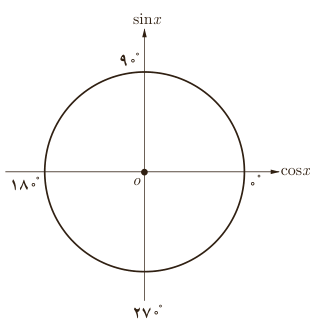

# درس دوم | روابط تکمیلی بین نسبت‌های مثلثاتی

۵) $\sin\frac{11\pi}4=\ldots$

۶) $\cos(-\frac{7\pi}4)=\ldots$

### تمرین

۱) حاصل هر یک از عبارت‌های زیر را به دست آورید:

الف) $\tan135^\circ+\cot120^\circ=$

ب) $\cos(-210^\circ)+\cot(240^\circ)=$

پ) $\sin630^\circ+\tan(-540^\circ)=$

ت) $\cos(-720^\circ)+\cot(-600^\circ)+\tan720^\circ-\tan(-600^\circ)=$

ث) $\sin(\frac{25\pi}3)-\cos(\frac{23\pi}4)=$

ج) $\displaystyle\frac{\sin\frac{3\pi}4-\cos\frac{5\pi}6}{\sin(-\frac{3\pi}4)+\tan(-\frac{4\pi}3)}=$

۲) جدول زیر را کامل کنید:

| زاویه $x$ | $120^\circ$ | $135^\circ$ | $150^\circ$ | $210^\circ$ | $225^\circ$ | $240^\circ$ | $300^\circ$ | $330^\circ$ |
|---|---|---|---|---|---|---|---|---|
| $\sin x$ | | | | | | | | |
| $\cos x$ | | | | | | | | |
| $\tan x$ | | | | | | | | |
| $\cot x$ | | | | | | | | |

۳) بدون استفاده از ماشین حساب درستی تساوی‌های زیر را بررسی کنید.

الف) $\sin840^\circ=\sin60^\circ$؛ ب) $\cos(-324^\circ)=\cos36^\circ$؛ پ) $\tan(-1000^\circ)=\tan80^\circ$؛ ت) $\sin875^\circ=\sin155^\circ$.

۴) در تساوی زیر به جای $x$ یک زاویه مناسب قرار دهید:

$$\sin x=\cos(20^\circ+x)$$

آیا برای زاویه $x$ تنها یک مقدار می‌توان یافت؟ جواب خود را با جواب‌های دوستان خود مقایسه کنید.

### خواندنی (کار با ماشین حساب)

با استفاده از ماشین حساب مطابق نمونه نسبت‌های مثلثاتی زاویه‌های $\frac\pi8$ رادیان و $\frac{3\pi}8$ رادیان را به طور تقریبی بیابید. (ماشین حساب باید در حالت رادیان باشد.)

$$\sin\frac{3\pi}8=\cos\frac\pi8\simeq0.9239$$

حاصل هر یک از نسبت‌های مثلثاتی زیر را با ماشین حساب به طور تقریبی به دست آورید:

$\tan20^\circ$ و $\sin\frac\pi{15}$ و $\cos105^\circ$ و $\tan\frac{3\pi}4$ و $\cos\frac{5\pi}9$ و $\tan170^\circ$.

۸۷
