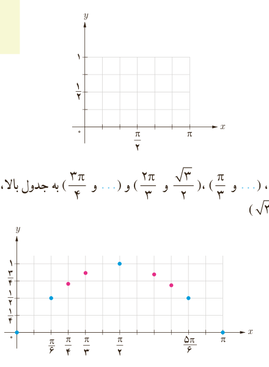

# فصل ۴ | مثلثات
## درس سوم: توابع مثلثاتی

توابعی نظیر تابع سینوس با ضابطه $y=\sin x$ و تابع کسینوس با ضابطه $y=\cos x$ نمونه‌هایی از توابع مثلثاتی‌اند که در این درس با نمودار آنها آشنا می‌شوید.

## رسم تابع سینوس

### فعالیت

۱) جدول روبه‌رو را کامل کنید. مجموعه زوج‌های مرتب حاصل در جدول مقابل یک تابع به صورت زیر مشخص می‌کند.

| $x$ | $y=\sin x$ | مختصات نقطه |
|---|---|---|
| ۰ | ۰ | $(0,0)$ |
| — | ... | ... |
| $\frac\pi2$ | ... | ... |
| $\frac{5\pi}6$ | ... | ... |
| $\pi$ | ... | ... |

$$f=\{(0,0),(\frac\pi6,\ldots),(\ldots,\ldots),(\ldots,\ldots),(\ldots,\ldots)\}$$

۲) نقاط حاصل در جدول را در شکل زیر مشخص کنید.

۳) با افزودن نقاط $(\frac\pi4,\frac{\sqrt2}2)$، $(\frac\pi3,\ldots)$، $(\frac{2\pi}3,\frac{\sqrt3}2)$ و $(\frac{3\pi}4,\ldots)$ به جدول بالا، شکل زیر به‌دست می‌آید. (با فرض $\sqrt2\simeq1.4$ و $\sqrt3\simeq1.7$)

۸۸
