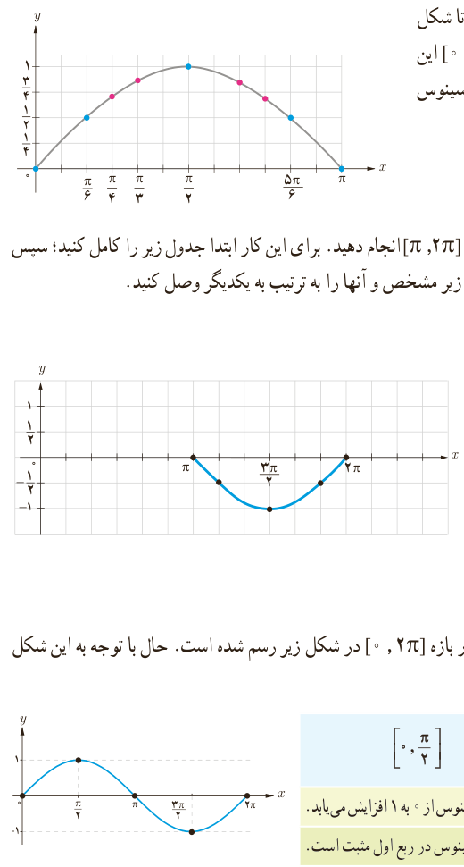

# درس سوم | توابع مثلثاتی

۴) نقاط حاصل در شکل را به‌ترتیب به یکدیگر وصل می‌کنیم تا شکل مقابل به‌دست بیاید. با افزودن تعداد نقاط جدول فوق در بازه $[0,\pi]$ این شکل به‌طور دقیق‌تری به‌دست می‌آید. شکل حاصل نمودار تابع سینوس با ضابطه $y=\sin x$ را در این بازه مشخص می‌کند.

۵) مراحل صفحه قبل را برای رسم نمودار تابع سینوس در بازه $[\pi,2\pi]$ انجام دهید. برای این کار ابتدا جدول زیر را کامل کنید؛ سپس نقاط به‌دست آمده در جدول را در صفحه مختصات مطابق شکل زیر مشخص و آنها را به ترتیب به یکدیگر وصل کنید.

| $x$ | $y=\sin x$ | مختصات نقطه |
|---|---|---|
| $\pi$ | ۰ | $(\pi,0)$ |
| $\frac{7\pi}6$ | ... | ... |
| $\frac{3\pi}2$ | ... | ... |
| $\frac{11\pi}6$ | $-\frac12$ | ... |
| $2\pi$ | ... | ... |

۶) با توجه به شکل‌های فوق، نمودار تابع با ضابطه $y=\sin x$ در بازه $[0,2\pi]$ در شکل زیر رسم شده است. حال با توجه به این شکل جدول زیر را درباره مقدار این تابع در هر بازه تکمیل کنید.

| $[0,\frac\pi2]$ | $[\frac\pi2,\pi]$ | $[\pi,\frac{3\pi}2]$ | $[\frac{3\pi}2,2\pi]$ |
|---|---|---|---|
| مقدار تابع سینوس از ۰ به ۱ افزایش می‌یابد. | | | |
| مقدار تابع سینوس در ربع اول مثبت است. | | | |

۷) با توجه به رابطه $\sin(x+2k\pi)=\sin x$، $k\in\mathbb Z$، که در درس قبل آشنا شدید می‌توان گفت:

$$\sin(x+2\pi)=\sin x$$

یعنی مقدار تابع سینوس با اضافه کردن $2\pi$ رادیان به کمان آن تغییری نمی‌کند. بنابراین نمودار تابع سینوس در بازه‌های $[0,2\pi]$ و $[2\pi,4\pi]$ یکسان است.

همچنین داریم:

$$\sin(x-2\pi)=\sin x$$

یعنی مقدار تابع سینوس با کم کردن $2\pi$ رادیان از کمان آن تغییری نمی‌کند. در نتیجه نمودار تابع سینوس در بازه‌های $[0,2\pi]$

۸۹
