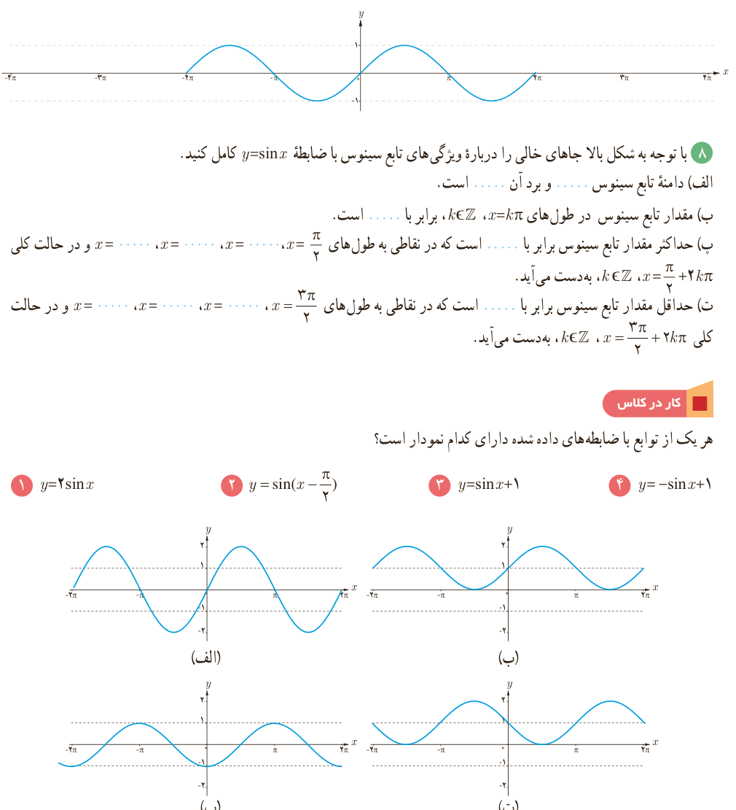

# فصل ۴ | مثلثات

و ........ یکسان است. در حالت کلی چون مقدار تابع سینوس با اضافه یا کم کردن مضارب زوج $\pi$ رادیان به کمان آن تغییر نمی‌کند، نمودار تابع سینوس در بازه‌های $[2k\pi,(2k+2)\pi]$، $k\in\mathbb Z$، یکسان است. به این ترتیب منحنی این تابع که در بازه $[0,2\pi]$ رسم شده در بازه‌های $[2\pi,4\pi]$، $[4\pi,\ldots]$، $[-2\pi,\ldots]$، $[-4\pi,\ldots]$ تکرار می‌شود.

در شکل زیر نمودار تابع سینوس در ۲ تکرار رسم شده است. این نمودار را برای ۴ تکرار کامل کنید.

۸) با توجه به شکل بالا جاهای خالی را درباره ویژگی‌های تابع سینوس با ضابطه $y=\sin x$ کامل کنید.

الف) دامنه تابع سینوس ........ و برد آن ........ است.

ب) مقدار تابع سینوس در طول‌های $x=k\pi$، $k\in\mathbb Z$ برابر با ........ است.

پ) حداکثر مقدار تابع سینوس برابر با ........ است که در نقاطی به طول‌های $x=\frac\pi2$، $x=\ldots$، $x=\ldots$، $x=\ldots$ و در حالت کلی $x=\frac\pi2+2k\pi$، $k\in\mathbb Z$، به‌دست می‌آید.

ت) حداقل مقدار تابع سینوس برابر با ........ است که در نقاطی به طول‌های $x=\frac{3\pi}2$، $x=\ldots$، $x=\ldots$، $x=\ldots$ و در حالت کلی $x=\frac{3\pi}2+2k\pi$، $k\in\mathbb Z$، به‌دست می‌آید.

### کار در کلاس

هر یک از توابع با ضابطه‌های داده شده دارای کدام نمودار است؟

۱) $y=2\sin x$؛ ۲) $y=\sin(x-\frac\pi2)$؛ ۳) $y=\sin x+1$؛ ۴) $y=-\sin x+1$.

۹۰
