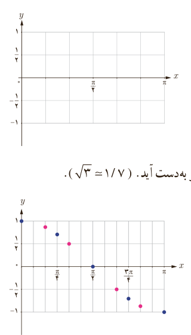

# درس سوم | توابع مثلثاتی

## رسم تابع کسینوس

### فعالیت

۱) جدول زیر را کامل کنید.

| $x$ | $y=\cos x$ | مختصات نقطه |
|---|---|---|
| ۰ | ۱ | $(0,1)$ |
| $\frac\pi4$ | $\frac{\sqrt2}2\simeq0.7$ | $(\frac\pi4,0.7)$ |
| $\frac\pi2$ | ........ | ........ |
| $\frac{3\pi}4$ | ........ | ........ |
| $\pi$ | ........ | ........ |

به این ترتیب مجموعه زوج‌های مرتب زیر به‌دست می‌آید.

$$f=\{(0,1),(\ldots,\ldots),(\ldots,\ldots),(\ldots,\ldots),(\ldots,\ldots)\}$$

آیا این مجموعه یک تابع را مشخص می‌کند؟

۲) نقاط جدول بالا را در این شکل مشخص کنید.

۳) نقاط به طول‌های $x=\frac\pi6,\frac\pi3,\frac{2\pi}3,\frac{5\pi}6$ را به جدول بالا اضافه کنید تا شکل زیر به‌دست آید. ($\sqrt3\simeq1.7$)

| $x$ | $\frac\pi6$ | $\frac\pi3$ | $\frac{2\pi}3$ | $\frac{5\pi}6$ |
|---|---|---|---|---|
| $y=\cos x$ | ... | ... | $-\frac12$ | ... |

۹۱
