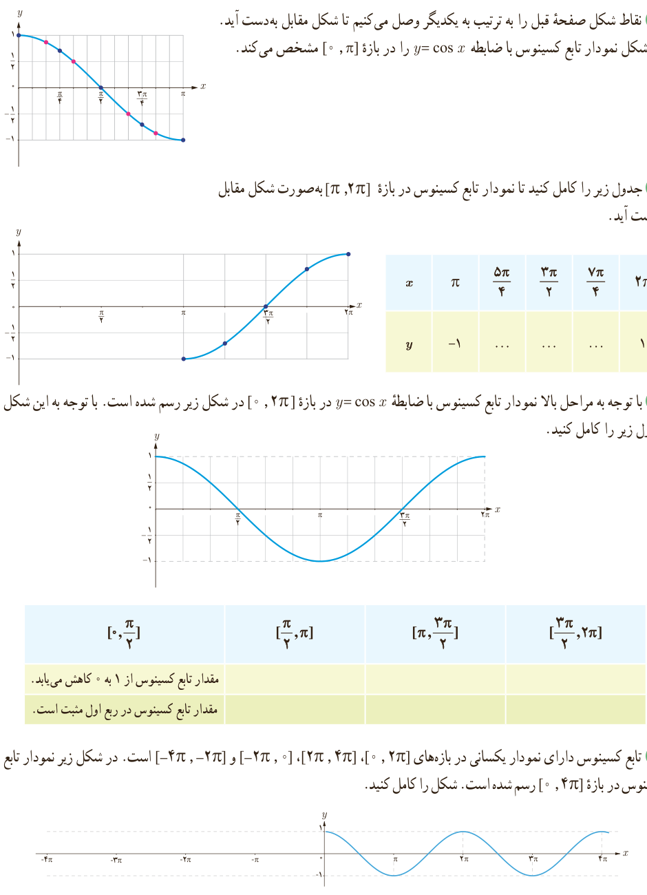

# فصل ۴ | مثلثات

۴) نقاط شکل صفحه قبل را به ترتیب به یکدیگر وصل می‌کنیم تا شکل مقابل به‌دست آید. این شکل نمودار تابع کسینوس با ضابطه $y=\cos x$ را در بازه $[0,\pi]$ مشخص می‌کند.

۵) جدول زیر را کامل کنید تا نمودار تابع کسینوس در بازه $[\pi,2\pi]$ به‌صورت شکل مقابل به‌دست آید.

| $x$ | $\pi$ | $\frac{5\pi}4$ | $\frac{3\pi}2$ | $\frac{7\pi}4$ | $2\pi$ |
|---|---|---|---|---|---|
| $y$ | −۱ | ... | ... | ... | ۱ |

۶) با توجه به مراحل بالا نمودار تابع کسینوس با ضابطه $y=\cos x$ در بازه $[0,2\pi]$ در شکل زیر رسم شده است. با توجه به این شکل جدول زیر را کامل کنید.

| $[0,\frac\pi2]$ | $[\frac\pi2,\pi]$ | $[\pi,\frac{3\pi}2]$ | $[\frac{3\pi}2,2\pi]$ |
|---|---|---|---|
| مقدار تابع کسینوس از ۱ به ۰ کاهش می‌یابد. | | | |
| مقدار تابع کسینوس در ربع اول مثبت است. | | | |

۷) تابع کسینوس دارای نمودار یکسانی در بازه‌های $[0,2\pi]$، $[2\pi,4\pi]$، $[-2\pi,0]$ و $[-4\pi,-2\pi]$ است. در شکل زیر نمودار تابع کسینوس در بازه $[0,4\pi]$ رسم شده است. شکل را کامل کنید.

۹۲
