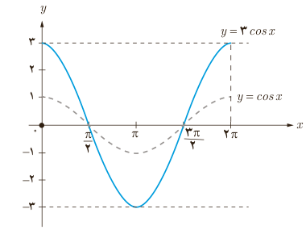

# درس سوم | توابع مثلثاتی

۸) با توجه به شکل صفحه قبل جاهای خالی را در خصوص ویژگی‌های تابع با ضابطه $y=\cos x$ کامل کنید.

الف) دامنه تابع کسینوس ........ و برد آن ........ است.

ب) مقدار تابع کسینوس در طول‌های ........ برابر با صفر است.

پ) حداکثر مقدار تابع کسینوس ........ است که در طول‌های $x=2k\pi$، $k\in\mathbb Z$، به‌دست می‌آید.

ت) حداقل مقدار تابع کسینوس ........ است که در طول‌های ........ به‌دست می‌آید.

### کار در کلاس

شکل زیر نمودار تابع با ضابطه $y=3\cos x$ را نشان می‌دهد. به‌طور مشابه هر یک از توابع با ضابطه‌های داده شده را در بازه $[0,2\pi]$، با استفاده از نمودار تابع کسینوس رسم کنید.

۱) $y=\cos(x+\frac\pi2)$؛ ۲) $y=\cos x-1$؛ ۳) $y=1-\frac12\cos x$؛ ۴) $y=\cos(x-\frac\pi2)+1$.

### تمرین

۱) آیا نمودارهای هر جفت از توابع با ضابطه‌های زیر بر هم منطبق‌اند یا خیر؟

۱) $y=\sin x$، $y=\cos(x-\frac\pi2)$

۲) $y=\cos x$، $y=\sin(\frac\pi2+x)$

۳) $y=\cos x$، $y=\cos(2\pi-x)$

۴) $y=\sin x$، $y=\sin(5\pi-x)$

۲) نمودار هر یک از توابع با ضابطه‌های زیر را در دستگاه مختصات در بازه‌های داده شده رسم کنید.

۱) $y=\frac12\sin x$، $[0,2\pi]$

۲) $y=2\cos x+1$، $[-2\pi,2\pi]$

۳) $y=1-\sin x$، $[-2\pi,2\pi]$

۴) $y=-1+\cos x$، $[-4\pi,4\pi]$

۵) $y=1+\sin(x+\frac\pi4)$، $[0,2\pi]$

۶) $y=\cos(x-\frac\pi2)$، $[2\pi,4\pi]$

۹۳
