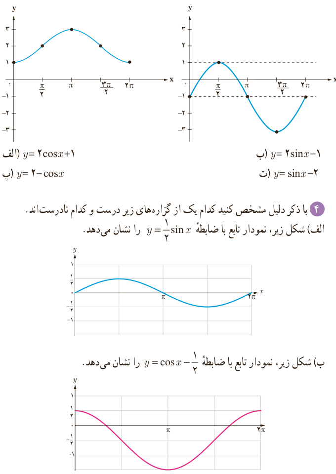
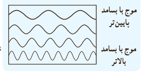

# فصل ۴ | مثلثات

۳) با توجه به نمودار توابع سینوس و کسینوس، مشخص کنید هر یک از دو نمودار زیر کدام یک از ضابطه‌های داده شده را دارند. نمودار تابع با سایر ضابطه‌ها را نیز رسم کنید.

الف) $y=2\cos x+1$؛ ب) $y=2\sin x-1$؛ پ) $y=2-\cos x$؛ ت) $y=\sin x-2$.

۴) با ذکر دلیل مشخص کنید کدام یک از گزاره‌های زیر درست و کدام نادرست‌اند.

الف) شکل زیر، نمودار تابع با ضابطه $y=\frac12\sin x$ را نشان می‌دهد.

ب) شکل زیر، نمودار تابع با ضابطه $y=\cos x-\frac12$ را نشان می‌دهد.

پ) برای رسم نمودار تابع با ضابطه $y=1+\sin x$ کافی است نمودار تابع سینوس را به اندازه یک واحد در راستای محور $x$ها انتقال دهیم.

ت) برای رسم نمودار تابع با ضابطه $y=-\cos x$ کافی است نمودار تابع کسینوس را نسبت به محور $x$ها قرینه کنیم.

### خواندنی

اصوات به‌صورت مخلوطی از موج‌های سینوسی شکل با بسامدهای مختلف می‌توانند نمایش داده شوند.

### خواندنی

طول روز به‌طور تقریبی در ایران در $t$امین روز سال برحسب ساعت با استفاده از تابع مثلثاتی $H$ با ضابطه زیر مدل‌سازی می‌شود.

$$H(t)=12+2.4\sin\frac{2\pi}{365}(t-1)$$

در این رابطه عدد ۱ که به‌معنای اولین روز سال یعنی اولین روز فروردین ماه است؛ اعتدال بهاری نام دارد. در این روز، مدت زمان روز و شب در سراسر کره زمین با هم برابر است. همچنین عدد ۱۲ تعداد ساعات روشنایی در یک روز به‌طور متوسط است. ضریب ۲٫۴ در این رابطه عددی است که اگر آن را با ۱۲ جمع یا از آن کم کنیم، طولانی‌ترین و کوتاه‌ترین مدت زمان روز در یک شبانه‌روز حاصل می‌شود که عبارت‌اند از ۱۴٫۴ ساعت (اول تیر ماه) و ۹٫۶ ساعت (اول دی ماه). عدد ۳۶۵ نیز تعداد روزهای سال است. به‌عنوان مثال طول روز در اول مهر ماه که ۱۸۷امین روز سال است، تقریباً برابر است با:

$$H(187)\simeq11.8\text{ ساعت}$$

حال، شما طول تقریبی روز را در روزهای ۱۲ اردیبهشت ماه، ۱۵ مرداد ماه، ۲۲ بهمن ماه و ۳۰ آذر ماه به دست آورید.

۹۴
