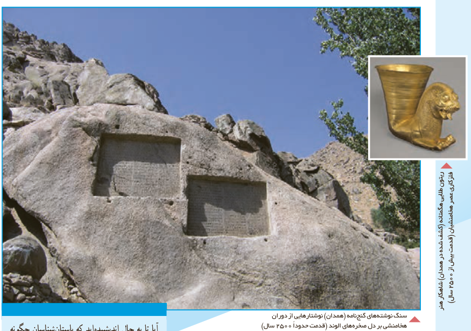

# فصل ۵ | توابع نمایی و لگاریتمی

سنگ‌نوشته‌های گنج‌نامه (همدان) نوشتارهایی از دوران هخامنشی بر دل صخره‌های الوند (قدمت حدوداً ۲۵۰۰ سال).

ریتون طلایی هگمتانه (کشف شده در همدان) شاهکار هنر فلزکاری عصر هخامنشیان (قدمت بیش از ۲۵۰۰ سال).

آیا تا به حال اندیشیده‌اید که باستان‌شناسان چگونه طول عمر یک اثر باستانی را تخمین می‌زنند؟ با استفاده از روش سال‌یابی کربن ۱۴، می‌توان عمر یک اثر باستانی را محاسبه کرد. در این روش، تعیین قدمت اثر، با یک تابع لگاریتمی مدل‌سازی می‌شود.

- درس اول: تابع نمایی و ویژگی‌های آن
- درس دوم: تابع لگاریتمی و ویژگی‌های آن
- درس سوم: نمودارها و کاربردهای توابع نمایی و لگاریتمی
