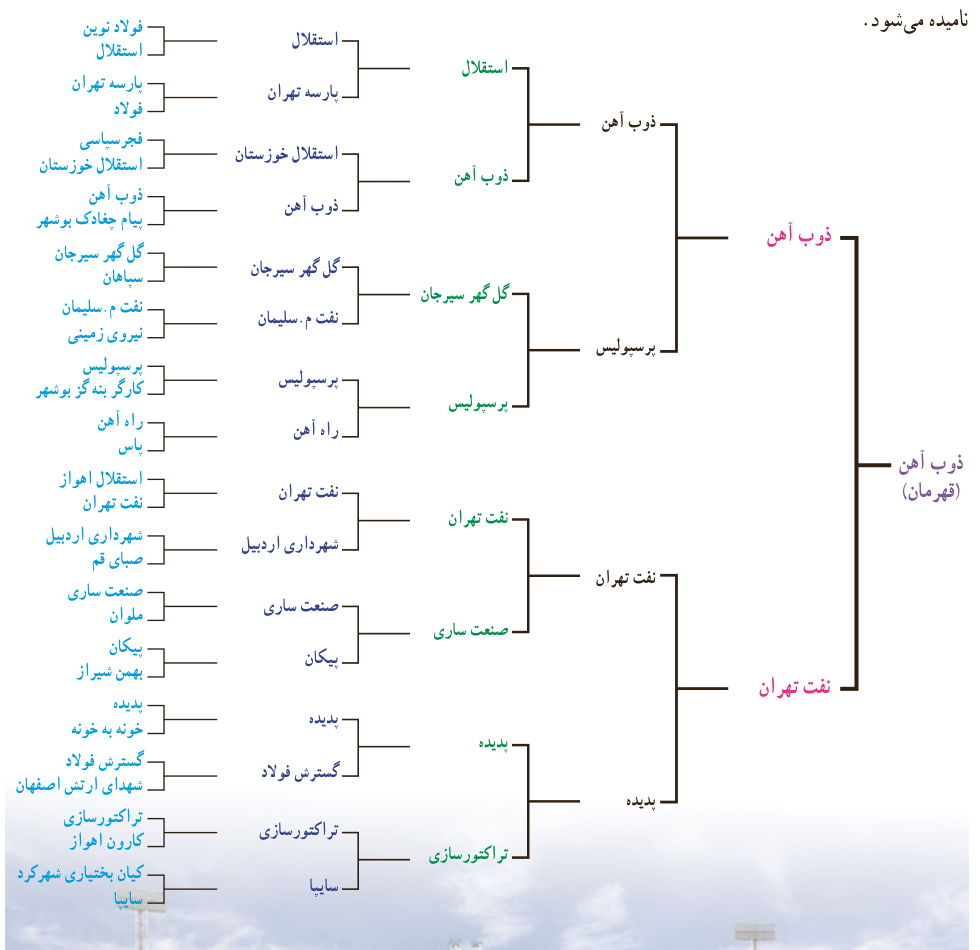

# فصل ۵ | توابع نمایی و لگاریتمی
## درس اول: تابع نمایی و ویژگی‌های آن

### فعالیت

مسابقات جام حذفی فوتبال ایران در فصل ۹۴–۹۳ با شرکت ۳۲ تیم و در پنج مرحله بازی از یک شانزدهم نهایی تا بازی نهایی به صورت زیر برگزار شد. همان طور که می‌بینید، در هر مرحله تیم برنده به مرحله بعدی می‌رود و تیم بازنده حذف می‌شود؛ به همین دلیل جام حذفی نامیده می‌شود.

۹۶
