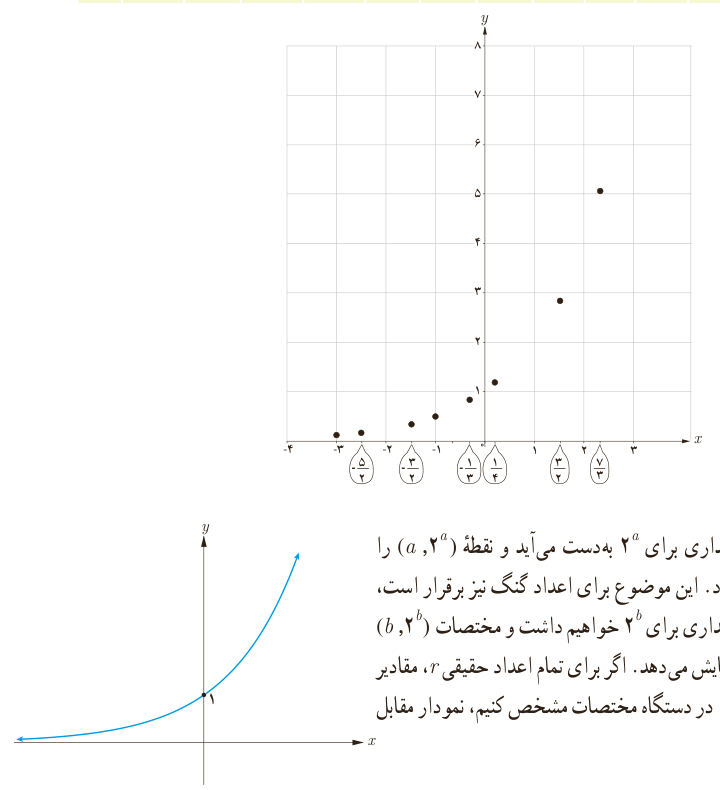

# درس اول | تابع نمایی و ویژگی‌های آن

۱) در بازی نهایی چند تیم حضور دارند؟ ........

۲) در مرحله قبل از بازی نهایی چند تیم حضور دارند؟ ........

۳) تعداد تیم‌ها در هر مرحله با تعداد تیم‌ها در مرحله قبل از آن چه ارتباطی دارد؟ ........

۴) چه رابطه‌ای بین تعداد مراحل و تعداد کل تیم‌های شرکت کننده در این مسابقات برقرار است؟ ........

۵) باتوجه به الگوی ارائه شده در شکل، اگر تعداد مراحل برابر ۶ باشد، تعداد تیم‌های اولیه چند تاست؟ ........

۶) اگر تعداد مراحل $x$ و تعداد کل تیم‌ها $y$ باشد، چه رابطه‌ای بین $x$ و $y$ برقرار است؟ ........

### فعالیت

جدول زیر را کامل و نقاط به‌دست آمده را در نمودار مشخص کنید. مقادیر به صورت تقریبی نوشته شده است.

| $x$ | −۴ | −۳ | $-\frac52$ | −۲ | $-\frac32$ | −۱ | $-\frac13$ | ۰ | $\frac14$ | ۱ | $\frac32$ | ۲ | $\frac73$ | ۳ |
|---|---|---|---|---|---|---|---|---|---|---|---|---|---|---|
| $2^x$ | ... | ۰٫۱۲ | ۰٫۱۸ | ... | ۰٫۳۵ | ۰٫۵ | ۰٫۷۹ | ... | ۱٫۱۹ | ... | ۲٫۸۳ | ... | ۵٫۰۴ | ... |

دیدیم که برای هر عدد گویای $a$، مقداری برای $2^a$ به‌دست می‌آید و نقطه $(a,2^a)$ را می‌توان در دستگاه مختصات نشان داد. این موضوع برای اعداد گنگ نیز برقرار است، یعنی برای هر عدد گنگ مانند $b$ نیز مقداری برای $2^b$ خواهیم داشت و مختصات $(b,2^b)$ نیز نقطه‌ای را در دستگاه مختصات نمایش می‌دهد. اگر برای تمام اعداد حقیقی $r$، مقادیر $2^r$ را به‌دست آوریم و نقاط $(r,2^r)$ را در دستگاه مختصات مشخص کنیم، نمودار مقابل به‌دست خواهد آمد.

۹۷
