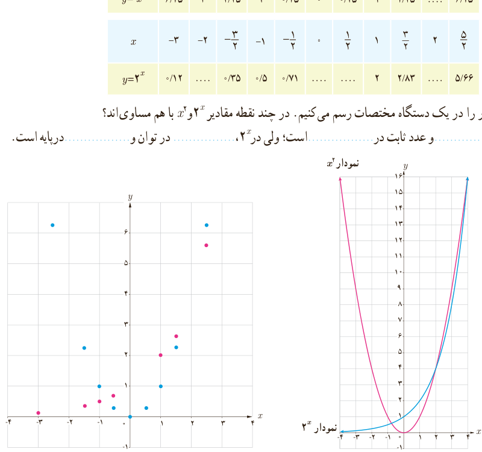

# فصل ۵ | توابع نمایی و لگاریتمی

## توان‌های حقیقی

در کتاب سال دهم، به ازای هر عدد حقیقی مثبت $a$ ($a\ne1$) و عدد گویای $\frac mn$، مقدار $a^{m/n}$ را تعریف کردیم و ویژگی‌های مقدماتی آن را به‌دست آوردیم. این قوانین برای توان‌های حقیقی نیز برقرار است؛ یعنی اگر $a$ و $b$ دو عدد حقیقی مثبت و مخالف ۱ و $x$ و $y$ دو عدد حقیقی باشند، داریم:

الف) $a^0=1$؛ ب) $a^{-x}=\frac1{a^x}$؛ پ) $a^xa^y=a^{x+y}$؛ ت) $(a^x)^y=a^{xy}$؛ ث) $(ab)^x=a^xb^x$؛ ج) $(\frac ab)^x=\frac{a^x}{b^x}$؛ چ) $\frac{a^x}{a^y}=a^{x-y}$.

### کار در کلاس

۱) جدول‌های زیر را تکمیل کنید. (مقادیر به‌صورت تقریبی نوشته شده است.)

| $x$ | $-\frac52$ | ... | $-\frac32$ | −۱ | $-\frac12$ | ۰ | $\frac12$ | ۱ | $\frac32$ | ۲ | $\frac52$ |
|---|---|---|---|---|---|---|---|---|---|---|---|
| $y=x^2$ | ۶٫۲۵ | ۴ | ۲٫۲۵ | ۱ | ۰٫۲۵ | ۰ | ۰٫۲۵ | ۱ | ۲٫۲۵ | ... | ۶٫۲۵ |

| $x$ | −۳ | −۲ | $-\frac32$ | −۱ | $-\frac12$ | ۰ | $\frac12$ | ۱ | $\frac32$ | ۲ | $\frac52$ |
|---|---|---|---|---|---|---|---|---|---|---|---|
| $y=2^x$ | ۰٫۱۲ | ... | ۰٫۳۵ | ۰٫۵ | ۰٫۷۱ | ... | ... | ۲ | ۲٫۸۳ | ... | ۵٫۶۶ |

۲) حال، این دو نمودار را در یک دستگاه مختصات رسم می‌کنیم. در چند نقطه مقادیر $2^x$ و $x^2$ با هم مساوی‌اند؟

۳) در $x^2$، متغیر در ........ و عدد ثابت در ........ است؛ ولی در $2^x$، ........ در توان و ........ در پایه است.

۹۸
